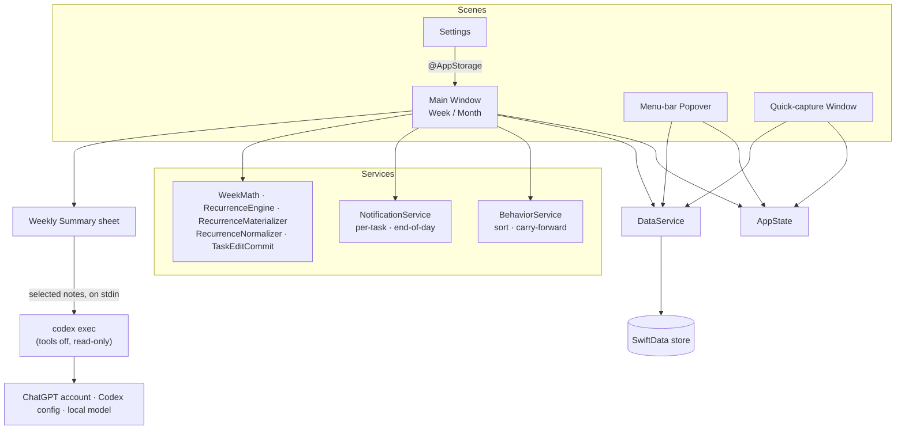

# TickyTask

A **native macOS** weekly & monthly planner — a privacy-first, local-only rewrite of [WeekToDo](https://weektodo.me) in **SwiftUI + SwiftData**. All your data stays on your Mac; there is no account, server, or telemetry. The one exception is **opt-in**: **Weekly Summary** sends the notes of the tasks *you* select to the AI you connect it to (through your locally installed Codex CLI) — only when you click Generate.

> **v0.1.17** (pre-release) · **macOS 26+** (Tahoe and later) · **Apple Silicon** · distributed **unsigned** (see install note below).

---

## Download & install

1. Download **`TickyTask-0.1.17-arm64.dmg`** from the [Releases page](https://github.com/nikhilkomakula/ticky-task/releases).
2. Open the DMG and drag **TickyTask** into **Applications**.
3. The app is **unsigned**, so macOS Gatekeeper blocks it on first launch — **right-click TickyTask → Open** and confirm, or clear the quarantine flag:
   ```bash
   xattr -dr com.apple.quarantine /Applications/TickyTask.app
   ```

Requires **macOS 26+** (Tahoe) on **Apple Silicon** — the rich-text notes editor uses SwiftUI's native `AttributedString` editor, which is macOS 26+. Because the build isn't signed/notarized, launch-at-login and local notifications won't fire until a signed build is produced.

## Features

- **Week view** (the default) — configurable 1–12 day columns, Monday/Sunday start, and an optional **show weekends** toggle (off by default — **Settings › Appearance**): when **on**, the view shows the full 7-day week (Saturday & Sunday included); when **off**, it shows weekday columns only (the column count sets how many), and previous/next/today navigation.
- **Month view** — a calendar grid showing every day's tasks, with a selected-day agenda panel; toggle between **Week** and **Month**.
- **Task editor** — title (grows to fit long titles that wrap to multiple lines), **rich-text notes** with a formatting toolbar and keyboard shortcuts — **⌘B / ⌘I / ⌘U** for bold / italic / underline, plus strikethrough, links, and **bulleted & numbered lists that continue on Enter and nest with Tab / Shift-Tab (sub-lists)** — optional time (off by default), **priority** (Low/Medium/High) that color-codes the task (green → orange → red), an optional **Critical** flag (off by default) that adds a red flag *before* the priority — independent of the priority level — and **subtasks** (a per-task checklist). A task with notes shows a small **notes glyph** on its row.
- **Custom lists** — a renamable, date-independent lists row beneath the week (defaults: *Requires immediate attention*, *To be addressed*, *Weekend tasks*, *Miscellaneous*) that persists across all weeks; resizable split. Add a list with **+ Add list**, rename it inline, and delete it with the **trash icon** in its header (or right-click) — confirmed first, since deleting a list also removes its tasks.
- **Sort by priority** — each day column and custom list with two or more tasks shows a **sort icon** in its header; one click arranges that column's tasks with the highest-priority incomplete ones on top (completed tasks sink to the bottom when *Move completed tasks to the bottom* is on) and keeps the order so you can still drag-adjust.
- **Drag & drop** — smooth, cursor-tracking reordering: drag a task to reorder it within a day or list, or move it **across days and across lists**, in the **Week** and **Month** views *and* the menu-bar popover — a lifted preview follows the cursor and an accent line shows exactly where it will land. Drop a task onto any day in the calendar grid (or the menu-bar mini-calendar) to move it there, and reorder the custom-list cards by dragging a card's grip handle.
- **Recurring tasks** — turn any day task into a repeating one from the editor's **Repeat** section: **daily**, **every weekday (Mon–Fri)**, **weekly** (pick which weekdays), **monthly** (same day-of-month), or **yearly**, with an **every-N-interval** and an end condition (**never** / **after N times** / **on a date**). Each due day gets its own occurrence, and repeating tasks show a small ↻ glyph.
  - **Updated everywhere:** a repeating task's **title, time, reminder, priority, and Critical flag** belong to the whole series — change them on *any* occurrence and every occurrence (past and completed ones included) updates.
  - **Kept per occurrence:** **notes, subtasks, and completion** belong to that one day only — new occurrences always start with empty notes, and nothing is ever copied from one day to another. The editor labels which fields are shared.
  - **Change or stop the schedule from any occurrence** (past, completed, moved, or in a list). Schedule changes apply **after today**: history, completed occurrences, and any occurrence you've worked on (notes, subtasks, completion, or moving it) are always kept; only untouched future ones are re-planned. (Sorting a day by priority is not counted as working on an occurrence.) **Stop Repeating** ends the series the same way.
  - **Move an occurrence** to another day or a list and its original day isn't refilled. **Delete This Occurrence** removes just that one (never the series, and never touches the next occurrence); **Delete Entire Series** removes every occurrence. Missed occurrences stay on their day (they don't pile onto today).
  - Edits are drafts until **Done**, which saves everything at once; **Cancel** (or Esc) discards them.
- **Behaviors** — sort by manual order / time / priority, move completed tasks to the bottom, **automatically carry unfinished tasks forward to today** (on by default — runs when the app opens, becomes active, or the day rolls over while it's left open; completed tasks and recurring occurrences stay put). When weekends are hidden, tasks skip the weekend and land on the next weekday, so a **previous Friday's unfinished tasks move to Monday** rather than an off-screen Saturday/Sunday. Optionally **auto-delete tasks completed more than N days ago** (off by default; N defaults to 7 and is configurable — **Settings › Behavior**).
- **Notifications** — optional per-task time reminders and a daily end-of-day "unfinished tasks" reminder.
- **Menu-bar app** — a **configurable** menu-bar icon (pick from several in **Settings › Appearance**; defaults to a calendar-with-checkmark) opens a mini calendar (Sunday-first, weekends highlighted) that **always opens on today**, with a **Today** button to jump back after browsing other months, and lists the **full day without scrolling**, plus inline quick-add; open the main window, reach Settings via the gear, **quit** the app (the power button, or **⌘Q**), or run menu-bar-only (no Dock icon).
- **Global shortcuts** — configurable hotkeys to open TickyTask, capture a new task for today, and **toggle the menu-bar popover** — from any app (**Settings › Shortcuts**).
- **Weekly Summary** — click the toolbar's **Weekly Summary** button (or **⇧⌘Y**), pick one or more tasks on each day of a week (‹ › to change weeks, or **Select all with notes**), and generate **one detailed overall update** from their notes — no dates, no per-day breakdown — ready to paste into a Jira ticket. Edit the draft, then **copy it with one click** (the copy icon, or **⇧⌘C**). It runs your locally installed **[Codex CLI](https://github.com/openai/codex)** with tools, MCP servers, and web search turned off, so the model only reads your notes. Connect it with:
  - your **ChatGPT account** (the default — `codex login`; a **Sign in** button is built in),
  - your **Codex CLI configuration** (`~/.codex/config.toml`, e.g. a company gateway), or
  - a **self-hosted model** — **Ollama**, **LM Studio**, or any **OpenAI-compatible** server (base URL, model, and an optional API key stored in your **Keychain**).

  Choose any model (**Refresh** fetches new ones; you can also type a model id) and the reasoning **effort**; your last choices are remembered. **Instructions** (audience, tone, length, format) come pre-filled with Jira-ready defaults that you can edit, clear, or restore — they're applied on top of built-in rules that treat notes as data and forbid inventing facts. Sign-in and other errors are explained with the fix and copyable details (status code, request id). **Settings › AI** holds the connection, instructions, and Codex path.
- **Search** — press **⌘F** (or click the toolbar's magnifying glass) to search every task by title and notes, then pick a result to jump straight to it.
- **Backup & restore** — export your entire store **and app settings** to a portable `.tickytask` JSON file (optionally passphrase-encrypted with **AES-256-GCM**, key derived via PBKDF2) and restore it later, with a change preview before anything is replaced. **Settings › Data**. Backups from earlier versions always import; backups made by 0.1.17 or later carry data schema 2 (inside the same envelope format 1), which older versions decline rather than misread. Kanban boards (in development for v0.2.0) travel in an optional, separately versioned `kanban` section: 0.1.17 restores the planner part of such a file and ignores the boards, and restoring a backup without that section keeps your boards.
- **Data location** — choose which folder holds your data (**Settings › Data**); changing it **moves everything there** and relaunches (or, if the folder already has a TickyTask store, adopts it). You can keep it in an **iCloud Drive / Google Drive / Dropbox** folder to carry your tasks between Macs — it's a live database, not real-time sync, so use one Mac at a time and let the folder finish syncing before opening it elsewhere.
- **Appearance** — System/Light/Dark theme, compact rows.
- **Launch at login** — starts TickyTask automatically when you log in (**Settings › General**, on by default; also manageable in System Settings › General › Login Items).
- **Software updates** — checks the project's GitHub Releases (latest stable **or pre-release**) for a newer version, manually or automatically (**Settings › General**).
- **About & Help** — app version, GitHub/issue links, license, and quick tips (**Settings › About**).
- **Polished native UI** — material day/list cards (custom lists align under the day columns), hover affordances, and refined typography; task titles **wrap to the available width** (in week columns and custom lists); opens **maximized** with a single toolbar: Week/Month switcher (left), the current date range (center), and **Search**, **Weekly Summary**, Settings, then ‹ **Today** › navigation at the far right.
- Clean gradient calendar app icon; first-run sample data.

## How it works

TickyTask is a single SwiftUI app with four scenes sharing one local SwiftData store and one `AppState`:

1. **Main window** — the Week/Month planner.
2. **Menu-bar popover** — a compact calendar + today's agenda + quick-add.
3. **Quick-capture window** — a tiny "new task for today" box opened by a global shortcut.
4. **Settings** — app preferences and data management.

Two things reach beyond your Mac: the update checker (GitHub Releases) and **Weekly Summary** (opened from the main window). Your task notes leave only when you click **Generate**: the sheet builds a JSON payload from the selected tasks' notes (no dates or ids), runs `codex exec` as a sandboxed, read-only child process with its tools, MCP servers, and web search disabled, passes the notes on stdin, and shows the reply. Before that, opening the sheet or Settings › AI asks Codex for your sign-in status and model list (for a self-hosted server, a `/models` request that carries your API key if you set one).

Tasks live in an on-disk SwiftData store (`~/Library/Application Support/TickyTask/TickyTask.store`). Views read it with live `@Query`s; task creation and ordering go through a single `DataService` (timestamps, sort indices, and the "day XOR custom-list" rule), while lightweight edits save directly to the context. Drag-and-drop reordering and cross-day/-list moves route through the same `DataService`, which re-derives sort indices and preserves the day-XOR-list rule. Pure logic (recurrence math, week/day-key math, sort & carry-forward behaviors) is isolated in `Services/` and unit-tested.

A **recurring series** is a hidden *definition* row (the rule plus the shared title, time, reminder, priority, and Critical flag) and one ordinary task row per occurrence — the first included. Each occurrence remembers the scheduled slot it was generated for (so moving it never frees that slot) and whether you've acted on it (so a schedule change only re-plans untouched future occurrences); a rule change also records the day it takes effect, so a new rule never back-fills the past. Opening a store or backup from an older version converts its series to this shape in one transaction (`RecurrenceNormalizer`): each old series row's own notes, subtasks, and completion move onto that same occurrence — never to another day. Editor commits (`TaskEditCommit`) write the shared fields to the whole series and everything else to the opened occurrence, in a single save. If a save fails, nothing reaches the disk: the change is undone in place and the editor stays open, or — when it had already removed rows, which SwiftData can't undo — TickyTask restarts without it and says so (`PersistenceRecovery`); that session skips auto-delete, so a store that keeps failing to save can't restart it again and again.

The **Kanban** module (in development for v0.2.0; design in [`design/kanban/`](design/kanban/)) adds eight models to the same store under automatic lightweight migration. Every board change goes through `KanbanService` in one save and appends a change-log entry that records per-field old and new values and per-card moves. Undo, redo and Change Log Revert apply an entry's inverse only after checking that nothing newer changed the same fields and that the board stays valid (`KanbanInvariants`). Card moves are planned as pure values (`KanbanMoves`). Boards start from a built-in or saved template (`KanbanTemplate`). The dashboard's numbers (load against capacity, the capacity heatmap, team composition, the cross-board people rollup, backlog, due dates and hygiene) are pure functions over a `MetricsSnapshot` (`KanbanMetrics`), so they're reproducible for a given time and calendar. In the window, **⌘1 / ⌘2** (or the Planner | Kanban switch at the top left) change module. The Kanban sidebar lists **Attention** (overdue, due-soon, blocked, Critical and unassigned urgent cards across every board), **All projects** (a card per board, plus a **People** tab that adds each person's allocation and load up across boards and flags anyone over 100 %), and your boards (pin, colour, duplicate structure, save as template, archive, delete; drag to reorder). A board shows people down the side and columns across the top, both kept in view while you scroll; each row header has the person's load gauge, employment and assignment icons, a roll-off badge and a cross-board warning, and rows collapse to their counts (⌥-click for all, or ⌃⌘↑ / ⌃⌘↓). Column headers show counts, WIP limits and hours, and their menu renames, recolours, limits, re-kinds, moves and deletes columns. Click a card to open its editor: title, rich notes, priority and Critical (the same controls as the planner's editor), column and assignee, labels, start and due dates, an estimate, a Jira link (checked, with its key shown), blocked with a reason, dependencies on other cards, subtasks (finishing the last one offers to move the card to Done), and the card's own history with Revert; archive or delete it from there. Hover a cell and click **+** to add a card there, or press **⌘N** for a new card in the backlog. Drag a card to another cell, onto a column header (keeps its person) or a row header, including a collapsed row (keeps its column); drag column headers and people's row headers to reorder them. While you drag, the board scrolls near its edges, the person's gauge previews the new load (e.g. `4 → 6/5`), and a column that would go over its WIP limit turns red (with a blocking limit the drop is refused). From the keyboard, with a card focused: arrows move between cards, **⌘← / ⌘→** change its column, **⌘↑ / ⌘↓** its person, **⌥⌘↑ / ⌥⌘↓** reorder it in its cell, **Return** opens it, **Space** shows a quick look and **M** opens a Move sheet; with a header focused, **⌥⌘** arrows reorder columns or rows.



## Build & run from source

Prerequisites: **macOS 26+**, **Xcode 26**, and **XcodeGen** (`brew install xcodegen`).

```bash
xcodegen generate            # generates TickyTask.xcodeproj from project.yml
open TickyTask.xcodeproj    # then Run (⌘R) — or build from the CLI:

xcodebuild -project TickyTask.xcodeproj -scheme TickyTask \
  -destination 'platform=macOS' build

# run the tests
xcodebuild test -project TickyTask.xcodeproj -scheme TickyTask \
  -destination 'platform=macOS'
```

**Your data is safe while you develop:** the Debug configuration (the default for `⌘R` and `xcodebuild test`) uses its own bundle id, `com.tickytask.mac.dev`, and its own default data folder, `~/Library/Application Support/TickyTask-Dev/`, so it never opens the installed app's store, shares its preferences or reminders, or quits it. Unit tests are hosted by an app that opens only an in-memory store (it stays out of the Dock and never takes focus); suites that check persistence open their own temporary on-disk stores, and UI tests (`-uitest`) use an in-memory store or an explicitly isolated temporary one.

**CI:** every pull request runs the unit tests ([`macos-ci.yml`](.github/workflows/macos-ci.yml)); the UI tests, which drive the real app with clicks, typing, and drags, run on a GitHub-hosted Mac for every push to a `feature/**` branch ([`ui-tests.yml`](.github/workflows/ui-tests.yml)) so they never take over a developer's screen.

The only third-party dependency is [KeyboardShortcuts](https://github.com/sindresorhus/KeyboardShortcuts) (resolved via Swift Package Manager).

### Opening the unsigned build

Because the app is not yet code-signed/notarized, Gatekeeper will warn on first launch. Right-click the app → **Open**, or clear the quarantine flag:

```bash
xattr -dr com.apple.quarantine /Applications/TickyTask.app
```

Note: macOS delivers local notifications only for code-signed apps, so the reminder features require at least an ad-hoc/Developer-ID signed build to actually fire.

### Releasing

`main` is protected — direct pushes are rejected, so every change lands through a **pull request** (self-merge is fine; no approvals are required). Cutting a release is two steps: merge the change via a PR, then tag the merged commit. Tags aren't branch-protected, so pushing a **`vX.Y.Z`** tag triggers the [`Release` workflow](.github/workflows/release.yml): it builds the arm64 Release app (the version is stamped from the tag), packages `TickyTask-X.Y.Z-arm64.dmg`, and publishes it as a GitHub pre-release — releases are no longer built by hand.

```bash
git switch -c release/x.y.z                  # branch — main rejects direct pushes
# …commit your changes (bump MARKETING_VERSION in project.yml, update this README)…
gh pr create --fill --base main              # open the PR
gh pr merge --squash --delete-branch         # self-merge once CI is green
git switch main && git pull                  # fast-forward local main to the merge
git tag vX.Y.Z && git push origin vX.Y.Z     # → CI builds the DMG and creates the release
```

## Roadmap

- Import from legacy WeekToDo `.wtdb` exports
- Localization (String Catalog)
- Signed & notarized **universal** DMG release (the app is currently unsigned/arm64)

## Tech stack

SwiftUI · SwiftData · Swift Testing · CryptoKit · XcodeGen · KeyboardShortcuts. macOS 26+ deployment, built against the macOS 26 SDK.

## Credits & license

A native macOS fork of **WeekToDo** by [Manuel Ernesto Garcia](https://manuelernestogr.bio.link/). Licensed under **GPL-3.0**, like the original.
