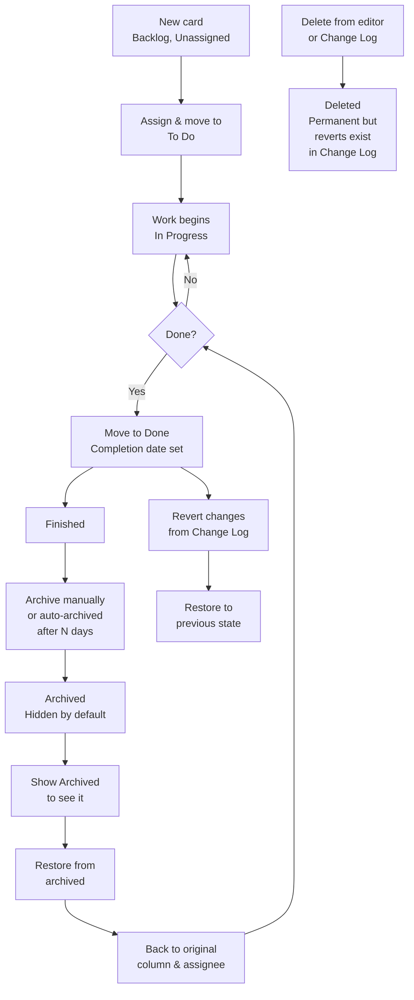
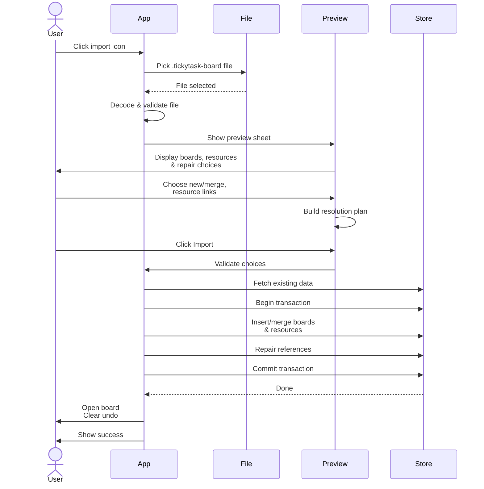
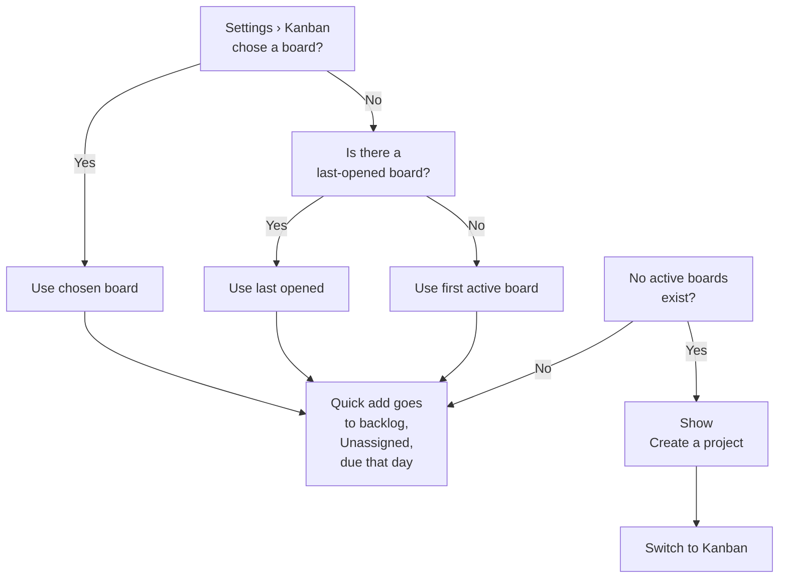

# Kanban User Guide

TickyTask's **Kanban** module helps you track work across teams with visibility into who is doing what, who is overloaded, and what is waiting to be pulled. It sits alongside the Planner in the main window, sharing your local data store.

---

## Getting started

**Turn Kanban on.** Open **Settings › Kanban** and toggle **Show Kanban**. The module appears next to the Planner in the top bar.

**Switch between modules.** Press **⌘1** for Planner or **⌘2** for Kanban. Or click the **Planner | Kanban** segmented control at the top of the window (it appears only when both modules are visible). To use different keys, open **Settings › Shortcuts**, click **Show Planner** or **Show Kanban** under **In TickyTask**, and press the new combination; click the field's **×** to clear it, or **Restore ⌘1 and ⌘2** to go back. A combination another menu item already uses is refused, so to swap the two, clear one first.

**Create your first board.** In the Kanban sidebar, click **New board**. Choose a template:
- **Default**: To Do → In Progress → Done.
- **Software**: Backlog → To Do → In Progress → In Review → Done.

Or load a saved template.

**Your default board.** The first time you go to Kanban after TickyTask starts, it opens your default board, so you don't have to click it. Choose it in **Settings › Kanban › Default board**, or right-click a board in the sidebar and choose **Default Board**. Until you choose, it's **The last opened board**: the board you last had open, or, if that's gone or archived, the first board in the sidebar (pinned boards first). Choose **All projects** to start on the overview instead. After that first visit, switching between Planner and Kanban keeps whatever you had open. Opening a card from the menu bar or search still goes to that card's board. The choice is kept on this Mac and isn't part of backups.

**Each board at a glance.** Under each board's name in the sidebar is the same summary as its All projects card: its load against capacity (for example *17 of 50 open tasks (34%)*, with the gauge coloured green, orange or red) and how many cards are open and done. Load counts only cards assigned to the board's resources and compares them with their targets, so it can differ from the open count, which includes unassigned cards. A red triangle beside the name means someone on the board is over capacity. Long names wrap onto a second line; hover to see the full name.

**Set it up.** Right-click a column header (or click its **⋯**) to rename it, set a WIP limit, or move it left or right. Choose **Appearance…** to pick its colour and icon: by default (**Automatic**, marked A) the colour follows its stage (to do red, in progress orange, done green) and the icon its name (an eye for "In Review", a hand for "Blocked", an hourglass for "Waiting") or its stage. Each pick applies at once and **⌘Z** undoes it; **Reset to automatic** goes back. Add resources using the **Add resource** button below the board's rows (see Resources and memberships below). Every new board starts with an **Unassigned** row pinned at the top.

---

## Resources and memberships

**Resources** are stored globally so you can add the same resource to multiple boards. When you add someone to a board, you create a **membership** that defines how much of their time that board gets.

**Create a resource.** Click the **Add resource** button below the board's rows to open the sheet. Choose **New resource**, or **Existing resource** to add someone already in TickyTask (for example from another board); the choice only appears when there's someone to pick. A resource has a name, initials and an employment type (employee or contractor); a new one also gets its allocation on this board.

**Set membership details on a board.** Right-click a row header and choose **Edit membership…**. Under **Resource (every board)** you can change their name, initials and employment type; these apply on every board they're on. Under **On this board**:
- **Role**: optional; shows only on this board.
- **Allocation %**: the share of their time this board gets (for example 50 % for someone half-time here). 100 % is full-time on the board and anything less is part-time; there's no separate full-time / part-time setting.
- **Weekly hours override** and **Open-task target override**: optional; they replace the board's defaults for this resource.
- **Starts on** and **Ends on**: optional; the end date is when they roll off the board.

The load target for each resource (how many cards they should have open) is the board's **Open-task target per resource** multiplied by their allocation %. A 50 % resource on a board targeting 5 cards has a target of 2.5. A board takes its target from **Settings › Kanban › New boards** when it's created (5 by default), and changing that setting later affects only boards created afterwards. To change one resource's target on a board, use **Open-task target override** in **Edit membership…**.

**Remove a resource from a board.** Right-click their row header and choose **Remove from board…**. Their cards move to **Unassigned** and can be undone from the **Change Log**.

**View all resources.** Click **All projects** in the sidebar, then select the **Resources** tab to see a summary of each resource and their allocation across all boards. This is a read-only report; edits to resource details must be made per-board in **Edit membership…**.

---

## Cards

**Add a card.** Press **⌘N** (or click the toolbar's **+ Card**) for a new card in the backlog, unassigned, or hover over a cell (a column and a resource's row) and click **+** for one in that column and row. Either way the full editor opens as **New card**, with every field below. Fill in what you need and click **Done** to add the card in one step (**⌘Z** removes it again), or **Cancel** to add nothing. Nothing is saved until you click Done, and a card needs a title.

**Edit a card.** Click any card to open the editor. Fields include:

- **Title** and **Details** (rich-text notes with **⌘B / ⌘I / ⌘U** for bold, italic, underline; also strikethrough, links, and bulleted & numbered lists that continue on Enter and nest with Tab / Shift-Tab).
- **On the board**: column, assignee, and labels.
- **Priority** and **Critical** flag (the flag is independent and always shown in red).
- **Complexity**: None (the default), **Low**, **Medium** or **High**, separate from priority and the estimate. When set, the card shows it among its markers as a small bar meter with *Low*, *Med* or *High* (hover for the full name). The List view has a sortable **Complexity** column, and right-clicking selected cards sets it for all of them.
- **Blocked** and optional reason.
- **Start date**, **Due date** and **Estimate** (hours; available on every board). The estimate counts toward load only on boards that measure load in hours; the card shows it either way.
- **Jira link** (validated; shows the key if recognized).
- **Depends on** (other cards in this project; while any of them isn't done, or is archived, the card shows **Waiting on n**).
- **Subtasks** (per-card checklist; completed items sink to the bottom).
- **History** (the card's change log, newest first; each entry has a **Revert** button if it can be undone).

**Mark it blocked.** Toggle **Blocked** and enter a reason. The card shows **Blocked** (hover for the reason), and it counts in dashboard charts.

**Read a card at a glance.** Below the title and labels, a card shows an icon for each piece of information that's set, risks first, so a quick review catches what needs attention:

| Icon | Shows | Means |
|---|---|---|
| raised hand, red | **Blocked** | Marked blocked; hover for the reason |
| exclamation mark, red | **Overdue 2d** | Past its due date by that many days |
| branch, amber | **Waiting on 1** | Something it depends on isn't done yet (or is archived); hover for which |
| clock, amber / calendar | **Due today**, **Due Oct 20** | Due soon (within the board's threshold) / its due date |
| calendar with clock | **Start Oct 21** | Its start date, while that's still to come |
| timer | **6h** | Its estimate |
| bars | **Low / Med / High** | Its complexity |
| checklist | **0/1** | Steps done of total |
| link | **PLAT-1234** | Its Jira issue; click to open it |
| note | — | It has notes |
| archive box | — | It's archived (shown with **Show Archived**) |

The Critical flag and the priority glyph sit before the title. Red and amber mean "needs attention"; everything else stays grey. A finished or archived card shows its dates without warning colours and no Blocked, Waiting or Start markers. Hover any icon for a full description.

**Assign it.** Use the **Assignee** picker in the editor, or drag the card to a row header to reassign it while keeping the column.

**Subtasks.** Add, rename, and toggle subtasks in the **Subtasks** section. Edits are drafts until you press **Done** in the editor. **Cancel** or Esc discards them. When you finish the last one and press Done, the editor offers to move the card to **Done** (if **Offer to move a card to Done when its steps are done** is on in Settings).

**Schedule to the planner.** Click **Schedule to day…** in the editor. Pick a day and confirm. The card creates or updates a planner task with the same title, priority, Critical flag, and notes (notes are copied once only; later reschedules just move the day). The editor shows a short confirmation ("On the planner for…"); there's no persistent link displayed. Scheduling cannot be undone.

**Duplicate a card.** Right-click it and choose **Duplicate**, or focus it and press **⌘D**. The copy (titled "… copy") lands right after it with the same fields, labels, dependencies and steps (steps start not done). It's one **Change Log** entry, so **⌘Z** removes it.

**Sort by priority.** The board's **Sort** menu includes **Priority** (Critical, High, Medium, then Low), which orders every cell on the board, for all resources at once.

**Archive a card.** Click **Archive** in the editor. Archived cards can be shown with **Show Archived** on the board toolbar.

**Delete a card.** Click **Delete…** for confirmation. Deletion is permanent but can be undone from the **Change Log** for as long as the entry is there.

---

## Moving work

**Drag a card.** Drag to another cell, column header (keeps assignee), row header (keeps column), or Unassigned. A lifted preview and accent line show where it will land. If a column's WIP limit would be exceeded, the header turns red with "over limit" and a count; if set to block, the drop is refused.

**Capacity preview.** While you drag or move a card, the target row's **load gauge** shows the projected load (e.g., **4 → 6 / 5**, meaning it goes from 4 to 6 cards against a target of 5).

**Completion.** Moving a card into **Done** sets the completion date. Moving between done columns keeps it. Moving out clears it.

**Keyboard moves** (with a card focused on the board):
- **⌘← / ⌘→**: move to the previous or next column.
- **⌘↑ / ⌘↓**: reassign to the previous or next row.
- **⌥⌘← / ⌥⌘→ / ⌥⌘↑ / ⌥⌘↓**: reorder within the cell or, with a header focused, reorder columns or rows.
- **M**: open the **Move** sheet to pick column and assignee.
- **⌃⌘↑ / ⌃⌘↓**: collapse or expand all rows.

**Select multiple cards.** **⌘-click** cards to add them to a selection. Dragging a selected card moves them all together. Right-click a selection to choose **Move to**, **Assign to**, **Label**, **Priority**, **Archive**, or **Restore** (each as one **Change Log** entry). Press **Esc** to clear.

**Reorder columns or rows.** Drag their headers left/right or up/down, or use **⌥⌘** arrows when focused.

---

## Finding work

**Search.** Press **⌘F** to search every task and card by title and notes. Results are grouped by module; click a card result to open the board with the card highlighted.

**Filter on the board.** Click the **Filter** icon (funnel) to filter by:
- **Title or notes** text.
- **Due** date (any, overdue, this week, next week).
- **Priority**, **Critical** flag, **Unassigned**, and **Open cards only**.
- **Blocked** cards, **Jira link** (has one or missing), **Estimate** (has one or missing).
- **Labels** and **Resources**.

Active filters appear as removable chips below the toolbar. Click **Clear** to reset all.

**Sort.** Click the **Sort** icon to sort by manual order, priority, due date, or title. The sort persists per board.

**Show Archived.** Click the archive icon to show or hide archived cards. This is remembered per board.

**Finished cards.** Each Done cell shows its five most recently finished cards, plus any without a completion date. Click **n older** under them to see the rest, and **Show fewer** to tuck them away again. The column header says how many show, e.g. **17 (5 shown)**; WIP limits and hours still count every card. To always see every done card on a board, right-click a Done column header and choose **Done cards › All**. A filter or **Show Archived** also shows everything.

**Archive done cards.** In the board's **⋯** menu, choose **Archive done cards…**, then either cards finished more than a number of days ago or all done cards. It covers every Done column and resource on the board, including cards hidden by filters, and is one **Change Log** entry, so **⌘Z** undoes it. Nothing is deleted: **Show Archived** brings the cards back into view.

**List view.** Switch to **List** in the top toolbar to see a sortable table with multi-select. Use right-click to bulk move, assign, label, or change priority.

**Timeline.** Switch to **Timeline** to see dated cards as bars, grouped by resource, with today marked.

---

## The dashboard

Switch to **Dashboard** to see your board's metrics. Each chart shows counts or hours depending on the board's **Measure load in** setting (Settings › Kanban › New boards). Charts include:

- **Load vs Capacity**: the number of open cards (or hours) each resource has against their target. Click a resource's button below the chart to filter the board.
- **Capacity, next 12 weeks**: a 12-week heat map showing when resources are busiest. Click a resource's button below the chart to filter the board.
- **Hours by column** / **Tasks by column**: how many cards (or hours) are in each column. Click a column to filter the board.
- **Unassigned Backlog**: cards waiting to be assigned, sorted by ready-to-pull status. Click to filter the board.
- **Due Dates**: cards grouped by due date (overdue, this week, next week). Click to filter the board to overdue cards.
- **Team**: employment types and allocation across the board (no drill-down).
- **Priority by column (hours)** / **Priority by column (tasks)**: cards by priority (Low, Medium, High, Critical) and column. Click a priority row to filter the board.
- **Hours with label** / **Tasks with label**: cards by label. Click a label to filter the board.
- **Blocked**: cards marked as blocked and why. Click to filter the board to blocked cards.
- **Age of work in progress**: how long cards have been in active work columns (excluding backlog; no drill-down).
- **Cumulative flow, 90 days**: card count over the past 90 days, showing new and completed work (no drill-down).
- **Completed work (by latest completion)**: completed work by week; reopened work moves out of earlier weeks (no drill-down).
- **Burn-up, 90 days**: scope (all cards added) and completed work over 90 days (no drill-down).
- **Hygiene**: counts of open cards with no due date, open cards with no Jira link, cards whose steps are all done but that aren't in Done, Done cards with open steps, resources with no open work, and resources past their end date who still hold work. **No due date** and **No Jira link** are links that open the board filtered to those cards; the other rows are counts only.

**All projects** doesn't combine the dashboards. Its **Boards** tab shows a card per board: its load against capacity, open and done counts, and how many cards are overdue, resources rolling off within 30 days, and resources over capacity. Its **Resources** tab lists each resource's allocation and load across all boards and flags anyone over 100 %.

---

## Availability

**Give the board dates.** Open **Board settings…** from the board's menu in the sidebar (or **Board actions** in the toolbar) and turn on **Starts on** and **Ends on**. You can also set them in **New board**. Both are optional. The Availability tab shows every week between them; without dates it shows 12 weeks from this week, with arrows to move.

**Read the tab.** Choose **Availability** in the view picker. Each row is a resource on the board, and each column is a week, always Monday to Sunday (the header shows the dates, with the month and year above). This week's column is highlighted with a subtle tinted background and labelled "This week" in the header. A cell shows how many days that person is available that week, after their recorded time off, out of the days they could work:

| Cell | Means |
|---|---|
| **5**, green | Available more than 60 % of the week (on a five-day week, more than 3 days) |
| **3**, yellow | Exactly 60 % (3 days) |
| **2.5**, red | Less than 60 % (fewer than 3 days) |
| **3**, green | A short week (the board starts midweek, or the person joins or leaves that week), fully available |
| — | They can't work that week on this board (outside the board's dates or their membership) |

The **Weekly availability** row (frozen below the header) shows the team's total available time that week as a percentage (floored) and the total days. The colour coding reflects capacity-planning thresholds: green for 80 % or more, amber for 60–79 %, and red for below 60 %. The number counts days present only: someone at 50 % allocation with no time off still shows 5 of 5 (their allocation shows in the row header when **Show allocation in row headers** is on). Card filters don't apply here.

**Record time off.** Click **Add time off** above the grid, or right-click a resource and choose **Add time off…**. Pick the dates, **Full day**, **Morning** or **Afternoon** (a single day), and a type (PTO, Sick, Personal, Training, Other), with an optional note. Time off belongs to the person, so it counts on every board they're on. **Time off…** lists, edits and removes someone's entries. Days covered by more than one entry count once.

**Override a week.** Click a cell (or focus it and press **Return**) to see the possible days, the time off counted and the result. **Override…** replaces that week's available days for this board (in half days), with an optional note; a small pencil marks the cell. **Clear override** goes back to the worked-out value. If you later change the board's or the person's dates so the week has fewer days than the override, the override is kept, marked with a warning, and not used until you change or clear it.

**Update from your PTO list (Update availability…).** If your team keeps PTO somewhere else (a Slack canvas, a spreadsheet, an email), you don't have to retype it:
1. Click **Update availability…**, or drop screenshots onto the grid.
2. Paste the text (select the canvas and copy it), and/or add screenshots with **Paste image**, **Choose files…** or drag and drop. Text usually reads more accurately than a screenshot.
3. Check the dates and people shown, read the note about what's sent, and click **Extract with Codex**. It uses the same Codex connection, model and privacy settings as the summaries (**Settings › AI**). Only what's shown is sent: the text, the images, the date range and the board's people's names.
4. Review the suggestions, grouped as:
   - **New**: ticked.
   - **Overlaps recorded time off**: not ticked. Each row shows what it replaces and what's kept; applying it replaces only its own days and half days.
   - **Name not matched**: pick the person; tick **Remember this name** to match it next time. Someone matched who isn't on this board starts unticked: tick them to include their time off.
   - **Overlaps another suggestion**: two suggestions cover the same days for one person; tick only one (Apply waits until you do).
   - **Needs review**: can't be applied as read, for example a half day over several days.
   - **Already recorded**: identical, so nothing to do.
   - **Couldn't be read**: unclear rows, with the reason.

   If something was misread, type a correction (*"Ravi means Ravindra"*, *"those dates are in November"*) and click **Refine** to read it again.
5. Click **Apply**. The line above it says how many entries, people and boards it affects. If someone's recorded time off changed while you were reviewing, Apply stops and asks you to check the rows again. It's one change in the Change Log, so **⌘Z** undoes it.

Nothing is applied without your review, nothing is ever removed because it's missing from the list, and the screenshots aren't kept. Re-pasting the same list later adds only what's new.

**Export it.** **⋯ › Export availability CSV…** saves one row per resource and week: possible, worked-out, overridden and effective days, allocation and status.

Every change here is one entry in the board's **Change Log**, and **⌘Z** undoes it. Undo refuses if the same time off was changed again since, on any board.

**Backups and board files.** Full backups include board dates, all time off, overrides and remembered names. A board file (**Export board…**) includes the board's dates and overrides, and its people's time off that overlaps the board's dates. For a board without both dates, you choose the range when exporting. Entries that overlap the range are included whole. Importing it adds time off to the matched people without duplicating what's already there. If an entry or a week's override in the file differs from what's recorded, the preview says how many; you can choose to use the file's version, and otherwise yours is kept. When merging into an existing board, you choose whether to use the file's board dates. Restoring a backup from before availability existed removes the time off recorded here, and the restore confirmation says so.

Arrow keys move between cells, **Return** opens the details and **Esc** closes them.

---

## Change log, undo and revert

**Undo and redo.** Press **⌘Z** to undo the last board change. Press **⇧⌘Z** to redo. These are scoped to the current project and cleared on relaunch.

**Change Log.** Click the **Change Log** button in the toolbar to see every board change, newest first. Each entry shows what changed and when. Click **Revert** to undo that specific entry, even if newer changes have been made (if there are conflicts, you'll see "This card changed after that entry. Revert the newer changes first.").

**What can't be reverted**: import, restore, and project hard-delete are irreversible. Entries before an import are also locked. Scheduling to the planner (Schedule to day…) cannot be undone.

---

## Kanban Summary

**Write a status update.** Click the **Kanban Summary** button in the toolbar (next to **Weekly Summary**). Pick cards to include using the selection view (**By resource** or **Whole board** — both group the selection the same way for display; the summary is always organized by resource and column). Click **Select all with notes** to pre-select cards that have notes. Choose your AI connection (ChatGPT account, Codex config, or local model) and the model/effort, then click **Generate**. The update uses card titles, status, resource, column, labels, priority, blocked state, Jira keys, subtasks, and notes—no ids or dates.

---

## Export, import and CSV

**Export a board.** Right-click a board in the sidebar and choose **Export board…** to save a `.tickytask-board` JSON file with the board's columns, labels, resources and cards.

**Export as CSV.** Right-click a board and choose **Export as CSV…** to save a spreadsheet for spreadsheet tools or other systems.

**Import a board.** Click the import icon (arrow down) in the sidebar to pick a `.tickytask-board` file. A preview shows:
- **Boards**: create new or merge into an existing board.
- **Resources**: link to existing resources or create new ones (by id first, then by name).
- **Repairs**: dropped dependency loops, unassigned cards from archived memberships, and completion mismatches.

Imported history is not included. Archived resources arrive archived, with their cards Unassigned. **Undo** doesn't reach past an import.

---

## Menu bar's Kanban mode

In the menu bar, when both Planner and Kanban are visible, click the **Planner | Kanban** segmented control to switch modes.

**Kanban mode** lists cards due on the day you pick (or today). It shows:
- **Overdue** cards (only when viewing today).
- **Due today** (or the chosen day) across all your active boards.

Click any card to open the main window on that board with the card highlighted.

**Quick add.** At the bottom, add a card to your chosen quick-add board (set in **Settings › Kanban › Menu bar**). The card goes to the board's backlog, Unassigned, due on the shown day. If no boards exist, click **Create a project…** to switch to the Kanban tab.

The menu bar's calendar now marks days with due Kanban cards so you can see at a glance which days are busy.

---

## Settings › Kanban

**Modules**: toggle **Show the Planner** and **Show Kanban** (at least one stays on); choose which opens at launch.

**Boards**:
- **Default board**: where Kanban opens the first time you go to it after TickyTask starts: the last opened board (the default), All projects, or a board you pick. A board you later archive or delete is skipped, and the last opened board opens instead.
- **Show allocation in row headers** (off by default): turn it on to show the part-time icon and percentage beside each name. Allocation still sets capacity.

**New boards** defaults:
- **Measure load in**: open tasks or hours. This affects all charts and capacity calculations.
- **Open-task target per resource**: the default load target (e.g., 5 tasks per resource).
- **Weight Critical and High cards**: if on, High and Critical cards count extra toward load (e.g., 2 or 1.5 × their count).
- **Over a WIP limit**: warn (show red but allow drop) or block the move.
- **Due soon: within N days**: the threshold for marking cards as due soon (default: 3 days).
- **Offer to move a card to Done when its steps are done**: when all subtasks are done, the editor asks if you want to move the card.

**Menu bar**: choose which board quick-add files into (last opened or a chosen board).

**Notifications**: toggle **Notify on Kanban due dates** and set the time.

**Archive**: toggle **Archive finished cards automatically** and set the delay (e.g., 30 days in Done).

**Templates**: view saved templates (from "Save as template…" on any board). Delete old ones here.

**Demo**: click **Load demo board** to load a sample project. Loading it again adds another copy.

---

## Backups and your data

Backups saved through **Settings › Data › Export** include your Kanban boards if you're running v0.2.0 or later. When you restore a backup:
- If it has a **kanban** section, your boards are replaced with what's in the file.
- If it doesn't (pre-Kanban backup), your existing boards stay.

Restoring a backup clears undo/redo for the board and imports. Everything is restored in one all-or-nothing transaction, so your data is safe.

**Data location** (Settings › Data): choose which folder holds your data. Changing it moves everything there. You can keep it in **iCloud Drive**, **Google Drive**, or **Dropbox** to carry tasks between Macs (use one Mac at a time and let the folder sync before opening elsewhere).

---

## Keyboard shortcuts

| Keys | Action |
|---|---|
| **Everywhere** | |
| ⌘F | Search tasks and cards |
| ⌘1 / ⌘2 | Switch to Planner / Kanban (changeable in Settings › Shortcuts) |
| ⌘/ | Show this shortcut list |
| **On the Kanban board** | |
| ⌘N | New card in the backlog |
| ⌘Z / ⇧⌘Z | Undo / redo a board change |
| ⌃⌘↑ / ⌃⌘↓ | Collapse / expand all rows |
| ⌘-click | Select multiple cards |
| Esc | Clear the selection |
| **With a card focused** | |
| ↑ ↓ ← → | Move focus between cards |
| ⌘← / ⌘→ | Previous / next column |
| ⌘↑ / ⌘↓ | Previous / next resource |
| ⌥⌘ arrows | Reorder within the cell |
| Return | Open the card editor |
| Space | Quick look (preview) |
| M | Move sheet (column & assignee picker) |
| **With a header focused** | |
| ⌥⌘← / ⌥⌘→ | Reorder columns |
| ⌥⌘↑ / ⌥⌘↓ | Reorder rows |

---

## How cards flow through a board

---

## How importing a board works

---

## How the menu bar picks the quick-add board

---

## Card lifecycle diagram: backup reference

Every card goes through these states:

- **Backlog, Unassigned**: ready to be picked up.
- **Active** (To Do, In Progress, etc.): someone is working on it or about to.
- **Done**: moved to a done column; completion date is set.
- **Archived**: hidden; can be shown with **Show Archived**; auto-archives if enabled in Settings.

From any state except deleted, you can:
- **Revert** a change from the Change Log (if newer changes haven't made it impossible).
- **Restore** from archived back to its original column and assignee. The assignee returns only if that resource is still on the board; otherwise the card is Unassigned.
- **Delete** it (permanent, but undoable via Change Log until the entry is gone).
- **Schedule to day** to link it with a planner task.

---

## Tips

- **Drag near column headers** to change a card's column while keeping its assignee.
- **Drag onto a row header** to reassign while keeping the column.
- **Drag onto Unassigned** to unassign immediately.
- **Collapse rows** (⌥-click a disclosure chevron or **⌃⌘↑**) to see counts and load gauges without scrolling through each resource.
- **Multi-select + right-click** lets you move, assign, label, or change priority for many cards at once, recorded as one Change Log entry.
- **Undo and redo** are per-project and remembered until relaunch; redo clears when you make a new change.
- **Change Log Revert** works even after a relaunch and catches conflicts; undo doesn't.
- **Dependencies** don't block movement but show visually on the card.
- **Subtasks** save when you press Done; finishing the last one can trigger a move-to-done offer.
- **Jira links** are validated when you save; the key is parsed from the URL.
- **Notes** can be rich text with formatting, links, and nested lists—just like in the planner.
