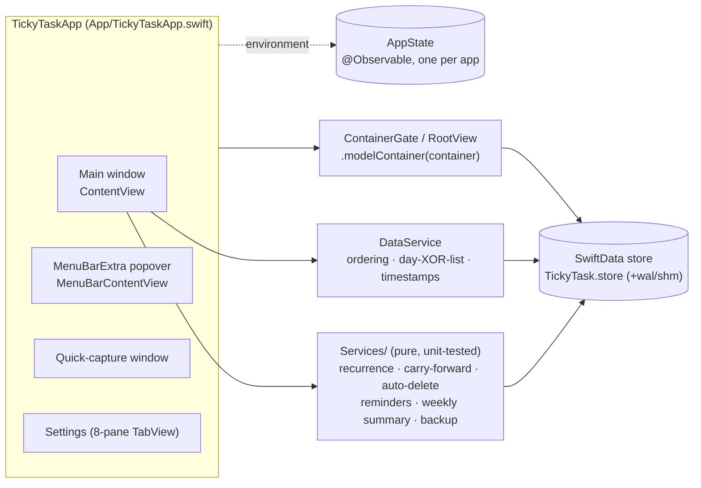

# 00 — Codebase summary (Phase 0)

Discovery for the multi-project resource Kanban, done against `main` at **v0.1.17** (`57f9890e`), not the README's
v0.1.16 snapshot. Every claim cites the file it came from; line numbers are as of that commit. Codex ran an independent
discovery pass. It agreed with B1, B2 and B6 and the sibling drag engine, and added B11–B15. Its findings are merged into §11 and logged in [DECISIONS.md](DECISIONS.md).

## 1. App shape in one picture

## 2. Data model (`Sources/TickyTask/Models`)

| `@Model` | Key properties | Relationships |
|---|---|---|
| **`TaskItem`** (not `Task` as the brief says) | `id`, `title`, `isDone`, `dayKey: String?` (yyyyMMdd), `customList?`, `timeMinutes?`, `alarmEnabled`, `sortIndex: Double`, `priority: Int` (0–2), `isCritical` (`@Attribute(originalName: "needsImmediateAttention")`), `colorHex?`, `notes: String` (plain-text projection), `notesRich: Data?` (JSON `NotesDocument`), `createdAt/updatedAt/completedAt?`, recurrence fields (`recurrence?`, `templateID?`, `occurrenceKey?`, `recurrenceEffectiveFromKey?`, `occurrenceModified?`) | `subtasks` (cascade, inverse `Subtask.parent`), `occurrences` (cascade), `tags` (many-to-many) |
| `Subtask` | `id`, `title`, `isDone`, `sortIndex` | `parent: TaskItem?` — **typed to `TaskItem`**, so it can't be shared with a second task type |
| `TaskOccurrence` | `dayKey`, `isDone`, `skipped`, legacy overrides | `template: TaskItem?` |
| `CustomList` | `id`, `name`, `sortIndex` | `tasks` (cascade) |
| `TaskTag` | `id`, `name`, `colorHex?` | `tasks` |

- **Priority** is `enum TaskPriority: Int` — `low/medium/high` with `label`, `symbol` (`arrow.down/minus/arrow.up.circle.fill`)
  and `tint` (green/orange/red) (`Models/TaskPriority.swift`). `TaskItem.priorityLevel` clamps the stored `Int`. **Critical** is
  an independent `Bool` rendered as a red `flag.fill` before the priority glyph (`Features/Task/TaskRowView.swift:40–47`). Both
  are reusable as-is by another model that stores `priority: Int` + `isCritical: Bool`.
- **Rich notes** are model-agnostic: `NotesDocument → NotesBlock → NotesRun` (Codable), `NotesCodec` (encode/decode,
  Markdown fallback), `NotesAttributedString` (document ⇄ `AttributedString`), `NotesEditingEngine` (pure), and
  `RichNotesEditor(text: Binding<AttributedString>)` — nothing in that folder references `TaskItem`.

### Schema evolution and migration
- `Persistence/AppSchema.swift` lists the five models. There is **no `VersionedSchema` / `SchemaMigrationPlan`**; every
  release has relied on SwiftData **automatic lightweight migration** (new properties optional or defaulted; the one rename
  uses `@Attribute(originalName:)`).
- The project rule (repo-root `CLAUDE.local.md`, "Every release must be backward compatible") forbids a hand-maintained
  multi-`VersionedSchema` plan: the versions share the same model classes and collide on *"Duplicate version checksums"*.
- v0.1.17 proved the approach on real stores: `Tests/TickyTaskTests/Fixtures/LegacyStores/{v0.1.1,v0.1.2,v0.1.8,v0.1.12,v0.1.15}`
  hold real stores plus plain/encrypted backups produced by each release's own code. `LegacyFixtureMigrationTests` reads ground truth
  straight from SQLite and checks every row survives.
- **Safe additive migration for Kanban** = add the new `@Model` types to `AppSchema.models`, all properties optional or
  defaulted, no change to existing models (or only additive optional ones), verified against those fixtures plus a new
  v0.1.17 fixture. This conflicts with the brief's "new `VersionedSchema` + lightweight migration stage" — see §11, B1.

## 3. Persistence invariants (`Persistence/`)

- **`DataService`** (`DataService.swift`): `addTask`, `dropTask(_:into:before:siblings:)` (reassigns day/list, renumbers the
  destination's `sortIndex`, one `saveTransaction`), `sortByPriority`, `reorderLists`, `addSubtask`, `addCustomList`,
  `delete(list)`. `TaskLocation` (`.day / .customList / .unassigned`) enforces day-XOR-list at the call site.
- **Transactions** (`ModelContext+Rollback.swift`, v0.1.17): `checkpoint()` commits unrelated pending edits first;
  `saveTransaction()` (with Debug fault injection); `undoFailedTransaction()` rolls back + refetches, **unless deletions are
  pending** — SwiftData's `rollback()` crashes undoing a deletion of a model with children, so the app turns autosave off,
  relaunches itself, and `_exit`s without saving (`PersistenceRecovery.swift`). Rule: **do every fallible step before the
  first deletion.**
- **No `UndoManager` anywhere** in the app (grep: no `undoManager`/`UndoManager`). ⌘Z today only works inside text fields.
- Data location (`ModelContainerProvider.swift`): `desiredDataDirectory` / `activeDataDirectory`; moves copy-then-rename
  every file with the store's name prefix, adopt an existing store, never overwrite. **Model-agnostic** — Kanban rows live
  in the same SQLite file and move with it automatically.

## 4. Main window, `AppState`, toolbar

- `TickyTaskApp`: main `WindowGroup(id: "main")` → `ContainerGate { ContentView() }`; `MenuBarExtra` (`.window` style);
  quick-capture `Window`; `Settings`. One `AppState` (`App/AppState.swift`) shared by all scenes: `weekAnchor`,
  `selectedDayKey`, `viewMode (.week/.calendar)`, `isSearchPresented`, `isWeeklySummaryPresented`, `highlightedTaskID`
  (2 s flash), `reveal(task)`.
- `ContentView` is the window root: `ZStack { VStack { TopToolbar; Divider; WeekView | CalendarMonthView }; DragOverlayView }`.
  **The toolbar is a custom in-content view (`TopToolbar`, 44 pt), not an `NSToolbar`/`.toolbar`** — so "each tab
  contributes its own `ToolbarItem`s" doesn't apply as written. Contents: Week/Month segmented picker · centred date label ·
  Search · Weekly Summary · Settings gear · ‹ Today ›.
- **Window-level responsibilities** that must stay above any tab container: `WindowConfigurator` (maximize), launch tasks
  (`runLaunchTasks`: seed, materialize, carry-forward, auto-delete, login item, reminder sync, update check) on first
  appear and on every `scenePhase == .active`, the 60 s day-rollover timer, store-restored / series-changed observers,
  activation policy (menu-bar-only), global-shortcut install, the "TickyTask restarted" alert, Search and Weekly Summary
  sheets, and the drag-frame preference collection.
- No `TabView` outside Settings; no `NavigationSplitView` anywhere.

### Keyboard shortcuts today
| Shortcut | Where |
|---|---|
| ⌘F Find task | menu command, `TickyTaskApp.swift:80` |
| ⇧⌘Y Weekly Summary | menu command, `TickyTaskApp.swift:96` |
| ⇧⌘C copy summary | `WeeklySummaryView.swift:437` |
| ⌘B/⌘I/⌘U | `RichNotesEditor.swift:62` |
| ⌘Q (popover) | `MenuBarContentView.swift:86` |
| Global (KeyboardShortcuts, user-set): open app, new task for today, toggle menu bar | `Services/Hotkey/GlobalShortcuts.swift` |

**There is no planner ⌘N and no "?" shortcuts overlay today** — both would be new.

## 5. Drag and drop (`Features/DragDrop/`)

A **custom engine**, not `.draggable`/`.dropDestination`:
- `DragController` (`@Observable`, one per window; the popover has its own) holds the drag state, the lifted preview
  task and the pointer.
- Rows publish their global frames through `RowFramesKey`; containers do the same through `ContainerFramesKey`
  (`ReorderPreferenceKeys.swift`). Both use `.global` coordinates — the v0.1.6 fix.
- `ReorderGeometry.resolveTarget` is pure and unit-tested. It picks the innermost accepting container, then the
  insertion index from the row midpoints along **one axis**.
- `DragOverlayView` draws the 1:1 lifted preview and the accent insertion line with a spring.
- `ReorderableRow` attaches a `.highPriorityGesture(DragGesture(minimumDistance: 4))`, so a click still opens the editor.
- The commit goes through `DataService.dropTask`. A drop within the same container forces `taskSortMode = manual`.
- `ReorderContainer` is a planner enum: `.weekDay(key)`, `.monthDay`, `.agendaDay`, `.list(UUID)`, `.listsRow`.
  `taskLocation()` maps it to `TaskLocation`.
- **There is no auto-scroll** (`ReorderableModifiers.swift:9`).
- **Verdict:** the engine is 1-D and planner-typed. The board needs a **sibling 2-D engine**: cells, column headers,
  row headers, collapsed rows, multi-selection and hover callbacks. It should reuse the overlay look (preview, spring,
  accent line) and `ReorderGeometry`'s midpoint rule so it feels identical. UI tests drag with
  `press(forDuration: 0.35, thenDragTo:)`.

## 6. Task editor and row (`Features/Task/`)

- `TaskEditorView` is a **sheet** (min 560×580, grouped `Form`). It is bound to `TaskItem`.
  - Sections: title; Details (rich notes); attributes (time, reminder, **priority picker = `ForEach(TaskPriority.allCases)`
    with `Label(label, systemImage: symbol)`**, Critical toggle); Repeat; Subtasks.
  - Drafts (`SharedAttributes`, `SubtaskDraft`, `TaskEdit`) are committed by `TaskEditCommit` in one transaction. Subtask
    edits are applied last, because they delete.
- `TaskRowView`: done circle; Critical flag; priority glyph; repeat glyph; wrapping title; notes glyph (`Has notes`);
  subtask badge `m/n`; bell; time (hidden in compact rows).
  - Hovering shows edit and trash buttons over the trailing metadata. On narrow columns they cover the middle of the
    title, as the v0.1.17 CI found.
  - Also: context menu; `taskRow-<title>` id; highlight flash; `compactView` AppStorage.
- Shared styling (`Features/Shared/UIComponents.swift`): `.cardSurface(selected:)` (regular material, 10 pt continuous
  radius), `QuickAddField`, `EmptyTasksView`.
- Theme: `appTheme` (`system`/`light`/`dark`) → `preferredColorScheme`.

## 7. Backup & Restore (`Backup/`)

- **Envelope** `BackupFile { format: 1, encrypted, store?, crypto? }`; the encrypted payload is AES-256-GCM with a
  PBKDF2-derived key. **`BackupStoreDTO`** has `schemaVersion` (now **2**), `appVersion`, `exportedAt`,
  `data: BackupDataDTO` (taskItems, subtasks, taskTags, customLists, taskOccurrences) and `settings: AppSettingsDTO?`.
- DTO fields are optional with stable JSON keys. `deterministicallySorted()` orders by UUID. Dates are ISO-8601 with
  fractional seconds. `notesRich` is base64 of the `NotesDocument` JSON.
- **Old readers:** `JSONDecoder` ignores unknown keys, but `BackupValidator.validate` **rejects
  `schemaVersion > currentSchemaVersion`**. v0.1.16 supports 1 and v0.1.17 supports 2.
  - So bumping `schemaVersion` to 3 makes v0.1.17 refuse the file outright.
  - An extra optional top-level `kanban` key under schemaVersion 2 is silently ignored by v0.1.17.
  - The brief asks for both (see §11, B2).
- **Restore** (`BackupStore.restore`): validate → checkpoint → fetch all → delete all → insert in dependency order →
  `RecurrenceNormalizer` → `saveTransaction`; fail-closed on failure. Then settings `apply()`, the `tickyTaskStoreRestored`
  notification, and the end-of-day reminder reschedule.
- **Preview:** `BackupDiff` with an `EntityDiff` (added / updated / removed) per entity, shown in the "Replace all TickyTask
  data?" sheet (`DataSettingsView`).
- **Settings payload:** `AppSettingsDTO` carries 15 keys plus the `weeklySummary` dictionary. Adding a key = an optional
  field + capture + apply + portable keys.
- **Tests:** `BackupTests`, `SeriesBackupRoundTripTests` (plain + encrypted, field-by-field), `AppSettingsBackupTests`,
  `LegacyFixtureMigrationTests`.

## 8. Other integration points

- **⌘F Search** (`Features/Search/SearchView.swift`): a sheet; `@Query` of all tasks → `TaskSearch.rank(…)` over
  title + notes → `app.reveal(task)` (switches week/month, sets the 2 s highlight). `DayColumnView` scrolls the highlight
  into view with `ScrollViewReader`.
- **Weekly Summary** (`Features/WeeklySummary`, `Services/WeeklySummary`, `Services/CLI`): a selection session plus
  `SummaryInputBuilder` (schema 1 JSON: no ids, dates or priorities; notes as rich blocks or Markdown; subtasks with status;
  256 KB cap).
  - Built-in rules plus editable custom instructions (`weeklySummary.instructions`, restorable default).
  - Invocation: `codex exec --json --skip-git-repo-check --ephemeral -s read-only --color never … --disable <12 features>
    -c web_search="disabled" -c mcp_servers.<each>.enabled=false [-m] [-c model_reasoning_effort] -o <file> -` with the
    prompt on stdin (`CodexSummaryAdapter.swift:26–39`).
  - Connection, model and effort are shared through Settings › AI.
  - A Kanban Summary can reuse the adapter, connection and copy UX unchanged. It needs its own snapshot/selection type,
    and the builder needs extra plain-text fields per record.
- **Menu-bar popover** (`Features/MenuBar`), width 340: header (gear / open / quit); `MiniMonthCalendar` (always Sun–Sat,
  task dots, Today); `DayAgendaView` (live `@Query`, inline `QuickAddField`); its own `DragController`.
- **Notifications** (`Services/NotificationService.swift`): `ReminderPlanner` builds `task.<uuid>` requests. Sync removes
  only stale ids **with the `task.` prefix** (line 61), so a `kanban.` prefix can coexist safely. The end-of-day reminder is
  separate.
- **Carry-forward** (`BehaviorService.carryForwardIncomplete`) and **auto-delete** (`AutoDeleteService`) fetch only
  `TaskItem`, so Kanban rows are ignored automatically.
- **First-run sample data** (`SampleData.seedIfEmpty`): 3 tasks and 4 lists; it won't create a Kanban project.
- **Network surface:** only `UpdateService`, which reads the GitHub releases API.

## 9. Tests and CI

- **Unit tests:** 45 Swift Testing files, **611 tests** (`@Suite`, `.serialized` for disk suites, `@MainActor`). They run
  hosted in the app with an in-memory store (`UITestSupport.isHostingUnitTests`) and on temporary on-disk stores where
  persistence matters.
- **UI tests:** 7 XCUITest files, **44 tests**.
  - `-uitest` gives an in-memory store and seeds Alpha/Bravo/Charlie today plus an Inbox list with ListA–C.
    `-uitestStore <path>` gives an isolated disk store.
  - Opt-in seeds and faults: `-uitestRecurringSeed`, `-uitestSummarySeed`, `-uitestSummaryDelay`,
    `-uitestSummaryFailure`, Debug-only `-uitestFailTaskSave`, `-uitestFailPurgeSaves`, `-uitestOldCompletion`.
  - Ids: `taskRow-`, `dayColumn-`, `daySort-`, `toolbar-*`, `editor-*`, `summary-*`, `list-*`, `menubar-*`.
- **CI:** `macos-ci.yml` runs unit tests on PRs and main. `ui-tests.yml` runs UI tests on `feature/**` pushes on a
  GitHub-hosted macos-26 runner with a 120-minute timeout; 44 tests took **≈34 min**.
  - That runner's screen is 1024×768. Day columns are lazy, and hover buttons cover narrow rows; the v0.1.17 helpers
    scroll and click a row's leading edge.
  - Budget: ≈0.75 min per test, so ~25 more journeys keep the run under an hour.
- **Release:** a `v*.*.*` tag triggers `release.yml`, which builds Release arm64, packages `TickyTask-X.Y.Z-arm64.dmg` and
  publishes a GitHub **pre-release**. The tag regex is **`^v[0-9]+\.[0-9]+\.[0-9]+$`, so `v0.2.0-beta.N` is rejected.**
  - Builds are ad-hoc signed and not sandboxed.
  - The About version comes from `git describe --tags --abbrev=0`.

## 10. Design reference: Karavan (App Store id6754577196, page fetched)
Verified on the App Store listing:
- pinned, colour-coded projects;
- a two-tier toolbar (filter chips scroll; Sort / Show Archived light up when active);
- sticky column headers and swimlanes;
- a subtle priority dot;
- user-chosen "finished" columns;
- subtasks that sink when done, with a suggestion to move the task to Finished;
- **Up Next** (the most urgent and high-priority tasks across projects);
- a Change Log with one-tap revert and undo/redo;
- search that scrolls to and highlights the match;
- shortcut tooltips and a Help cheat sheet.

Out of scope per the brief: iCloud sync, attachments, Pomodoro, the Eisenhower matrix, custom task types. Not
verifiable without the app: the exact shortcut list and how Up Next groups items.

## 11. Findings that touch the brief

| # | Kind | Finding | Proposed handling |
|---|---|---|---|
| B1 | **Conflict** | The brief asks for "a new `VersionedSchema` + lightweight migration stage". The project rule and all 17 releases use automatic lightweight migration; a multi-`VersionedSchema` plan collides on duplicate checksums. | Additive new `@Model` types under automatic lightweight migration, tested against real v0.1.1…v0.1.17 stores. **Needs your confirmation.** |
| B2 | **Conflict** | "Bump the `.tickytask` schema version" and "a pre-Kanban build ignores the Kanban key gracefully" can't both hold: v0.1.17 rejects `schemaVersion > 2`. | Keep `schemaVersion = 2`; add an optional top-level `kanban` section carrying its own `kanbanSchemaVersion: 1`. Old builds ignore it; new builds version it. **Needs your confirmation.** |
| B3 | Conflict | The target `v0.2.0` sits below existing tags `v2.0.0`–`v2.2.0`. Those are the **upstream WeekToDo Electron** tags (v2.2.0 = 2024-02-12) still reachable in `main`'s history. GitHub *releases* are only v0.1.0–v0.1.17, so the update checker is unaffected, and `git describe` picks the nearest tag (v0.1.17). | Use **v0.2.0** as intended and record the reasoning. **Needs your confirmation** (the brief's rule would otherwise push it to v2.3.0). |
| B4 | Note | The planner model is `TaskItem`, and `Subtask.parent` is typed to it. | Separate `KanbanSubtask`. Link to the planner by id (see the design). |
| B5 | Note | No `UndoManager` exists, and SwiftData `rollback()` crashes undoing deletions. `ModelContext.undoManager` is unproven under the fail-closed design. | Undo/redo is built on `KanbanActivity` inverse operations; ⌘Z reverts the last Kanban activity. Codex to review. |
| B6 | Note | No native toolbar or `TabView` in the main window; the toolbar is a custom view. | A window-level root with a module switcher in the top bar; each module renders its own bar contents. |
| B7 | Note | There's no ⌘N in the planner and no "?" overlay. | Both are new: ⌘N acts only in the Kanban tab; the overlay is a new sheet listing all shortcuts. |
| B8 | Note | The release regex rejects `-beta.N`. | Only relevant if you ask for a preview; widening the regex is a one-line change. |
| B9 | Note | The `design/` folder exists but only holds `appicon.svg`. | `design/kanban/` follows the brief. |
| B10 | Note | Settings has **8** panes (General, Appearance, Behavior, **Notifications**, Shortcuts, Data, AI, About). | Settings › Kanban becomes a 9th pane. Modules and Default view go in General. |
| B11 | Risk (Codex) | `undoFailedTransaction()` refetches only the five planner types after a rollback (`ModelContext+Rollback.swift:13`). | Add the Kanban types to the refetch list in increment 1. |
| B12 | Risk (Codex) | A v0.1.17 build restores the planner part of a Kanban-era backup, but **drops the boards if you re-export from it**. v0.1.16 rejects schema-2 files outright. | Document it in the README's backup section and in the restore preview text. |
| B13 | Risk (Codex) | Legacy series normalisation can give a split first occurrence a new UUID and hide the old row as a definition (`RecurrenceNormalizer.swift:63`). | Resolve `linkedPlannerTaskID` after normalisation; never link to a hidden definition (`recurrence != nil`). |
| B14 | Risk (Codex) | Today's drag engine moves exactly one UUID per save (`DataService.swift:54`). | Multi-select moves are one batch `MovePlan` applied in a single transaction; never loop single-card saves. |
| B15 | Note (Codex) | v2.x are inherited WeekToDo tags (v2.0.0 `96d51901` 2022, v2.1.0 `4e313b85` 2023, v2.2.0 `afeb6523` 2024; `upstream` remote). None of them is published as a GitHub release on origin; checked with `gh release list`. | Confirms B3. |
