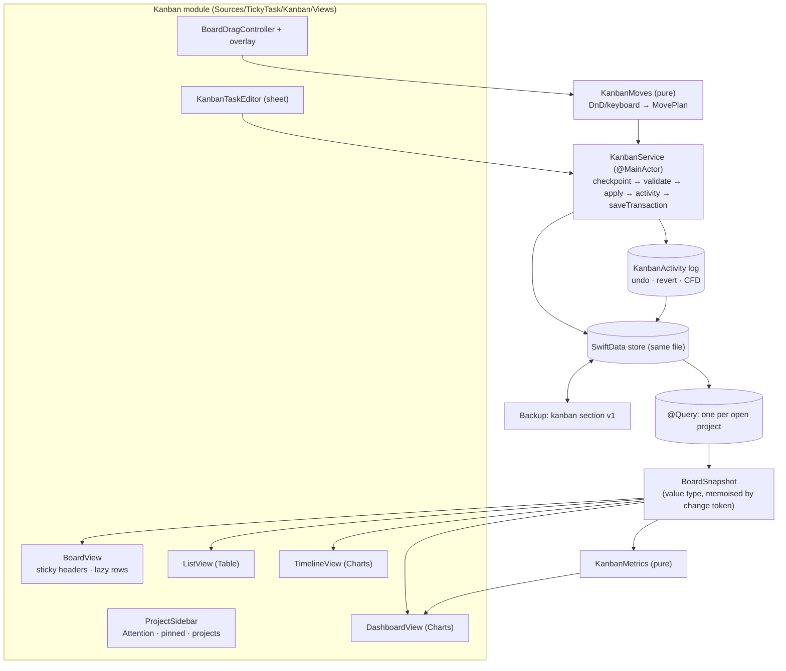
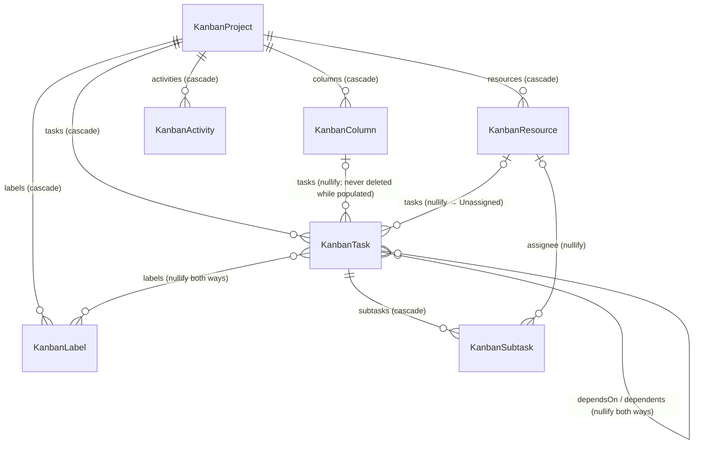

# 01 — Kanban design (Phase 1)

Status: **approved by Codex (review R4) — awaiting your confirmation.** Builds on [00-codebase-summary.md](00-codebase-summary.md);
formulas live in [02-metrics.md](02-metrics.md); every Codex review outcome is in [DECISIONS.md](DECISIONS.md).
Nothing here changes planner behaviour unless a section says so.

## How this actually works

**What it is.** A second module in the main window, **Kanban**, next to the existing **Planner**. A Kanban *project* is a
board. Its columns are statuses (To Do → In Progress → Done). Its rows are the people working on it (*resources*), with
an always-on-top **Unassigned** row. Each card is a `KanbanTask`. The board answers three questions:

- who is over- or under-loaded, and when;
- what is assigned to whom, and in what state;
- what is still waiting for an owner.

**What happens, step by step.**
1. **Open the Kanban tab** (⌘2, or the segmented switcher in the top bar). The project sidebar lists Attention, then pinned
   projects, then the rest. Picking a project loads **one** SwiftData query for that project's tasks plus its columns and
   resources.
2. **Snapshot.** The query result is grouped in memory into a `BoardSnapshot`: cells keyed by column × resource, with
   per-row and per-column counts. The snapshot is rebuilt only when `KanbanService` bumps the project's change token. Every
   view and every metric reads the snapshot; no cell runs its own query.
3. **Render.** The grid is one two-axis scroll view. Column headers stick to the top and row headers stick to the left
   (offset by the scroll position). Rows are lazy, and a collapsed row is a one-line strip of counts plus a load gauge.
4. **Act.** Dragging a card, a keyboard move, the editor or a bulk action produces a `KanbanMutation`. `KanbanService`
   applies it in **one save**:
   1. checkpoint unrelated edits;
   2. validate (WIP policy, invariants);
   3. apply field changes and re-derive sort indices;
   4. write one `KanbanActivity` describing how to undo it;
   5. `saveTransaction`.

   If the save fails, it's undone in place. If deletions were pending, the existing fail-closed restart applies.
5. **See the consequences.** The dashboard, Attention, popover and search all recompute from the snapshot or a small
   cross-project query. The Change Log lists activities, and **Revert** (or ⌘Z) applies an activity's inverse as a new
   mutation.
6. **Back it up.** The `.tickytask` backup gains an optional `kanban` section with its own version. Old builds ignore it;
   new builds restore it in the same all-or-nothing transaction as the planner data.

**Guardrails.**
- Automatic lightweight migration only.
- No planner model changes.
- Every destructive action is either undoable through the activity log or confirmed.
- Archive is the default, rather than delete.
- WIP limits are off; when set, they only warn.
- The Codex sandbox is unchanged.
- No network calls.

**In practice.** ⌘2 → "+ Project" (Default template) → "Add your first resource" → add Ravi (FTE, full-time) and Mia
(contractor, 50 %, ends next month) → ⌘N adds cards to Unassigned → drag a card onto Ravi's row header (reassign) → drag
it onto *In Progress* (status) → the Dashboard shows Ravi at 5/5 open (100 %, amber) and Mia at 3/2.5 (120 %, red) → the Kanban Summary
writes a per-resource status update → quit; relaunch; back up; restore — everything is still there.

## 1. Data model

New `@Model` types live in `Sources/TickyTask/Kanban/Models/` and are appended to `AppSchema.models`.

**Migration:** additive, using SwiftData automatic lightweight migration.
- No `VersionedSchema` (this deviates from the brief; see DECISIONS D1).
- No existing model changes.
- Every property is optional or defaulted, so a v0.1.17 store opens unchanged and simply gains empty tables.
- Enums are stored as raw values (`Int`/`String`) with typed computed accessors, as `TaskItem.priority` already does. This
  keeps `#Predicate` usable and decoding forgiving.

| Model | Properties (defaults) | Notes |
|---|---|---|
| `KanbanProject` | `id`, `name`, `key` ("PLAT"), `details` (""), `colorHex`, `symbolName`, `sortIndex`, `isPinned` (false), `createdAt`, `updatedAt`, `archivedAt?`, `workWeekDays: [Int]` (Mon–Fri, `Calendar` weekday numbers), `hoursPerDay` (8), `defaultCapacityHoursPerWeek` (40), `wipPolicyRaw` ("warn"), `loadMeasureRaw` ("taskCount"), `openTaskTarget` (5), `defaultEstimateHours` (4), `weightedLoad` (false), `dueSoonThresholdDays` (3), `suggestDoneWhenSubtasksComplete` (true), `collapsedRowKeys: [String]` ([]), `boardState: Data?`, `nextActivitySeq: Int` (1) | `sortIndex` orders the sidebar. **`collapsedRowKeys`** (resource UUID strings + `"unassigned"`) replaces the brief's `expandedResourceIDs`: new rows start expanded with no bookkeeping, and Unassigned has a key (D7). `boardState` is a Codable `BoardViewState` (last view, filters, sort, density, show-archived). `nextActivitySeq` gives activities a persisted total order (B7). |
| `KanbanColumn` | `id`, `name`, `sortIndex`, `colorHex?`, `wipLimit: Int?`, `kindRaw` ("backlog"/"active"/"done") | Exactly one `.backlog` and ≥ 1 `.done` column per project (see the invariants in §2). |
| `KanbanResource` | `id`, `name`, `initials`, `role?`, `colorHex?`, `employmentRaw` ("fte"/"contractor"), `assignmentRaw` ("fullTime"/"partTime"), `allocationPercent` (100), `capacityHoursPerWeekOverride: Double?`, `openTaskTargetOverride: Double?`, `startDate?`, `endDate?`, `skills: [String]`, `sortIndex`, `archivedAt?` | Unassigned is **not** a resource (`task.resource == nil`). A resource belongs to one project (D15). |
| `KanbanTask` | `id`, `title`, `notes` (""), `notesRich: Data?`, `priority: Int` (0–2), `isCritical`, `sortIndex`, `dueDate?`, `startDate?`, `estimateHours: Double?`, `jiraURL: String?`, `isBlocked`, `blockedReason?`, `linkedPlannerTaskID: UUID?`, `createdAt`, `updatedAt`, `completedAt?`, `archivedAt?` | Notes use **the planner's storage** (`NotesCodec` JSON + plain-text projection). `jiraKey` is computed (`/[A-Z][A-Z0-9]+-\d+/`). The planner link is a UUID, not a relationship (D3). |
| `KanbanSubtask` | `id`, `title`, `isDone`, `sortIndex`, `completedAt?` | Separate from the planner's `Subtask`, whose parent is typed to `TaskItem`. Done items sink, ordered by `completedAt`, then `sortIndex`. |
| `KanbanLabel` | `id`, `name`, `colorHex`, `symbolName?`, `sortIndex` | Seeded per project: Feature, Bug, Enhancement, Tech Debt, Spike, Documentation, Chore. |
| `KanbanActivity` | `id`, `seq: Int`, `at`, `kindRaw`, `taskIDs: [UUID]`, `summary`, `payload: Data` (versioned Codable `ActivityPayload`), `revertsActivityID: UUID?`, `revertedByActivityID: UUID?` | Plain-UUID task references outlive deleted tasks. `seq` comes from `project.nextActivitySeq`, inside the same save. The payload contract is in §2.3. |

### 1.1 Relationship contract (every declaration explicit)

| Property (owner side) | Type | Delete rule | Inverse | Ownership check (service + backup validator) |
|---|---|---|---|---|
| `KanbanProject.columns` | `[KanbanColumn]` | cascade | `KanbanColumn.project: KanbanProject?` | — |
| `KanbanProject.resources` | `[KanbanResource]` | cascade | `KanbanResource.project` | — |
| `KanbanProject.labels` | `[KanbanLabel]` | cascade | `KanbanLabel.project` | — |
| `KanbanProject.tasks` | `[KanbanTask]` | cascade | `KanbanTask.project` | — |
| `KanbanProject.activities` | `[KanbanActivity]` | cascade | `KanbanActivity.project` | — |
| `KanbanColumn.tasks` | `[KanbanTask]` | **nullify** | `KanbanTask.column: KanbanColumn?` (optional so `.nullify` is legal; non-nil enforced by the service) | `task.column.project == task.project` |
| `KanbanResource.tasks` | `[KanbanTask]` | **nullify** (the task becomes Unassigned) | `KanbanTask.resource: KanbanResource?` | `task.resource?.project == task.project` |
| `KanbanResource.subtaskAssignments` | `[KanbanSubtask]` | **nullify** | `KanbanSubtask.assignee: KanbanResource?` | same project as the subtask's task |
| `KanbanTask.subtasks` | `[KanbanSubtask]` | cascade | `KanbanSubtask.task: KanbanTask?` | — |
| `KanbanTask.labels` | `[KanbanLabel]` | **nullify** | `KanbanLabel.tasks: [KanbanTask]` (nullify) | same project |
| `KanbanTask.dependsOn` | `[KanbanTask]` | **nullify** | `KanbanTask.dependents: [KanbanTask]` (nullify) | same project; **no self edges or cycles** |

- **Dependency edges never cascade.** Deleting a task removes its edges only.
- **Cycles are refused** by `KanbanService.addDependency` with a message.
- **Imports and restores drop any self-edge or cycle-closing edge** (deterministically: the edge whose source id sorts
  last) and report the count in the preview, rather than rejecting the whole file.
- Enums are stored as raw values with typed accessors, as `TaskItem.priority` already is.

**D1 verification gate (increment 1, required before merging):**
- open real v0.1.1 / v0.1.2 / v0.1.8 / v0.1.12 / v0.1.15 stores **and a new v0.1.17 fixture store**;
- build the full seven-model graph on disk: self-referential `dependsOn` edges, `[Int]`/`[String]` arrays, raw enums,
  every delete direction;
- save, close, reopen, and compare the exact graph field by field.

Automatic migration of these relationships is a hypothesis until this gate passes.

### 1.2 Physical deletions and the fail-closed rule

SwiftData's `rollback()` crashes when it has to undo a deletion. A failed save that has deletions pending therefore
restarts without rollback (`ModelContext+Rollback.swift:13`). Every path that physically deletes rows follows **prepare →
delete → save once**:
1. finish every fetch, validation step and payload encoding first;
2. then delete;
3. then call `saveTransaction` exactly once.

A failure before step 2 rolls back in place; a failure at step 3 fails closed.

The paths:
- deleting a column (after its tasks have moved);
- removing a subtask;
- deleting a label or dependency edge;
- hard-deleting a resource, task or project from the Archive view;
- undoing a create;
- restore and import.

(Reverting a restore-from-archive re-archives the row; it doesn't delete it.)

**Permitted work after the first deletion.** Only **non-throwing, in-memory** steps on objects already in hand may run
between the deletions and the save:
- inserting from already-decoded DTOs;
- `RecurrenceNormalizer.normalize(inserted)`;
- link repair against an in-memory id set.

`normalize` is non-throwing; its one fetch (`nextSortIndex`, `RecurrenceMaterializer.swift:255`) uses `try?` and falls back
safely. Anything that throws after a deletion goes through the fail-closed restart, so the disk is left unchanged.

Each path gets a fault-injection test (§9). `undoFailedTransaction()` also refetches the Kanban types after an in-place
rollback (B11).

## 2. `KanbanService`, pure moves, history

### 2.1 Moves (pure)
`KanbanMoves.plan(_ op: MoveOp, in snapshot: BoardSnapshot) -> MovePlan` is pure and `nonisolated`.
- It turns a drag, keyboard command or bulk action into exact field changes, sort indices and completion transitions,
  plus a WIP outcome: `.ok`, `.warn(column)` or `.blocked(column)`.
- A multi-selection is **one** plan, with its relative order preserved (column order, then row order, then sort index).
  Plans are never applied as a loop of single-card saves (B14).
- Every row of §4 has a unit test.

### 2.2 Service invariants (`KanbanService`, `@MainActor`)
Every mutation follows the same sequence:
1. Checkpoint unrelated edits.
2. Validate.
3. Apply the change.
4. Append one activity, taking `seq` from `project.nextActivitySeq`. A bulk action appends one grouped activity.
5. `saveTransaction`.
6. Bump the store generation (§2.5).

Invariants:
- Sort indices are re-derived densely within every affected cell, column list and row list.
- **Columns.** There is exactly one `.backlog` column.
  - You can't delete it. "Make this the backlog" on another column swaps the two kinds atomically. **Both columns
    must be empty**, which is consistent with the rule against changing a populated column's kind below.
  - There is at least one `.done` column, and the last one can't be deleted.
  - Deleting a populated column requires a target column. Its tasks move there, with the matching completion transitions,
    in the same save.
- **A populated column's kind can't change** (B7). The sheet says "Move its tasks first", so completion state never changes
  without a task-move event.
- **Resources.** Archiving or deleting a resource sends its tasks to Unassigned in the same save (the UI confirms first).
- **Completion.**
  - Entering `.done` from a non-done column sets `completedAt = now`.
  - A **Done→Done move keeps `completedAt`.**
  - Leaving `.done` clears it.
- **Subtasks** are never auto-completed. Finishing the last open subtask returns `.suggestDone` when the project allows it.
- **Ownership.** Every reference must point within the same project (§1.1).

### 2.3 Activity payloads (deltas, not full rows)
`ActivityPayload` (version 1) has one case per `kind`. Each case carries **per-task transitions with expected values**,
so it can be both replayed and reversed:

| Kind | Payload |
|---|---|
| `created` | task id, column `{id, name, kind}`, resource id?, plus the full task DTO (needed to undo the create safely) |
| `moved` (single or grouped) | `[ {taskID, from: {column{id,name,kind}, resource?, sortIndex, completedAt?}, to: {...}} ]` |
| `edited` | `[ {taskID, field, old, new} ]` for changed fields only; `isBlocked` is a field (needed by 02-metrics) |
| `archived` / `restored` | task ids with their previous `archivedAt` |
| `deleted` (task, label) | the **full DTO graph** of what was removed (subtasks, labels, edges) |
| `deleted` (column) | the column's DTO, plus a **transition for every surviving task it held**: `from` = its old placement and `to` = the target column, new sort index and new `completedAt`. Replay treats these as moves; a revert checks each task's `to` before moving it back. |
| `deleted` / `archived` (resource) | the resource's DTO, plus each task's transition `{resource: r → nil, sortIndex old → new}` (and subtask assignee → nil). These replay as resource-only moves and are conflict-checked on revert. |
| `restoredGraph` (the inverse of a delete) | the re-inserted DTO graph, plus the forward transitions that move the migrated tasks back. Replay applies them like `created` + `moved`. |
| `scheduled` (Schedule to day…) | the Kanban task id, the planner task id, the day. **Informational only:** the planner row belongs to the planner (which has no undo), so it isn't put on the undo stack and has no Revert button. You unschedule from the planner. |
| `structure` (columns or resources added, renamed or reordered; WIP or kind changes) | entity id, field, old, new |

- Ordinary edits and moves store deltas. Only destructive actions store graphs. This keeps the log small; 02-metrics §5
  has the size budget.
- **Project hard-delete is irreversible.** Its activities cascade away with it, so the UI asks for confirmation and says so.

### 2.4 Undo, redo, Revert (D5)
`ModelContext.undoManager` stays **off**: it would capture planner edits too, and it is unproven next to fail-closed
recovery.

`KanbanHistory` keeps per-session `undo` and `redo` stacks of activity ids, scoped to each project:
- **A user operation** pushes onto `undo` and clears `redo`.
- **⌘Z** pops the top of `undo` and applies its inverse as a new activity (`revertsActivityID` = original). The original
  moves to `redo`. Generated inverse activities are **never** pushed onto `undo`, so ⌘Z can't undo its own undo.
- **⇧⌘Z** pops `redo`, re-applies the original's forward transitions as a new activity, and pushes the original back onto
  `undo`.
- Stacks change **only after the save succeeds**. They are cleared on restore and import, and on a relaunch.

**Revert from the Change Log** works on any entry, including after a relaunch:
- It is **conflict-checked**. Every transition's *expected current* values (an `edited` entry's `new` value, or a `moved`
  entry's `to` placement) must match the live row; otherwise it refuses before changing anything: "This card changed
  after that entry. Revert the newer changes first."
- A successful Revert counts as a user operation: it is pushed onto `undo` and clears `redo`.
- Reverting a delete re-inserts the stored graph, including the migrated placements for a column delete. Links are
  **revalidated** first: planner links are re-resolved (§7) and invalid references are dropped and reported, never
  resurrected.
- **Redo** re-applies the *recorded* `to` values, including the original `completedAt`; it doesn't stamp "now". "Now" is
  stamped only by fresh moves.
- Irreversible entries (project hard-delete, `scheduled`, entries before a restore) show no Revert button.

### 2.5 Store generation and clock (B6)
One `KanbanStoreGeneration` counter (`@Observable`, held in `AppState`) is bumped by:
- every `KanbanService` save;
- an in-place rollback;
- `tickyTaskStoreRestored`;
- a Kanban import.

`BoardSnapshot` and `KanbanMetricsCache` are keyed by `(projectID, generation, clock)`.
- `clock` = `(dayKey(now), timeZoneID, weekStartsMonday)`.
- It is re-read on the root's 60 s timer (which already watches for the date changing), on activation, on
  `NSSystemTimeZoneDidChange`, and when `weekStartsMonday` changes.
- A day change therefore invalidates the cache without a store change. `now` is taken fresh on every rebuild.

A restore or import also clears `KanbanHistory`, the selections, and any open editor drafts for rows that no longer exist.

## 3. Main window: modules and tabs

- `AppState` gains `module: AppModule (.planner/.kanban)`, `kanban: KanbanNavigation` (selected project, view, sidebar
  selection) and `highlightedKanbanTaskID`, plus `revealKanban(taskID)`.
- **Switcher (D2):** the top bar is a custom view today, not an `NSToolbar`. So the module switch is a compact segmented
  control at the leading edge of that bar:
  - **Planner** (`calendar`) | **Kanban** (`square.grid.3x2`);
  - shortcuts ⌘1 / ⌘2 (menu commands);
  - hidden when only one module is visible.

  A native `TabView` was considered and rejected. It can't host our custom bar per tab, and it would split the window-level
  drag overlay and launch tasks.
- `ContentView` stays the window root, owning everything listed in 00 §4. Its body becomes `TopBar(module:)` followed by
  either `PlannerModuleView` or `KanbanModuleView`:
  - `PlannerModuleView` is today's Week/Month body, moved verbatim.
  - The bar shows planner controls (Week/Month, date label, ‹ Today ›) or Kanban controls (§5).
  - The Search, Weekly Summary and Settings buttons stay global. In the Kanban module, the Kanban Summary button is added
    next to Weekly Summary.
- **Module policy** (`ModulePolicy`, pure, unit-tested):
  - `showPlanner` and `showKanban` (both `true` by default);
  - at least one module is always on — the last enabled toggle is disabled;
  - the effective default module and the popover's initial mode are both resolved through this policy.

  It is stored in `@AppStorage` and included in the backup settings.

  Hiding the planner also turns off quick-capture and the "new task for today" global shortcut; Settings › Shortcuts
  explains why. Carry-forward, recurrence and reminders keep running whether or not the planner is visible.

## 4. Drag and drop (sibling engine, identical feel)

`Kanban/Views/DragDrop/`:
- **`BoardDragController`** (`@Observable`) tracks the dragged ids, the pointer, the target and the modifier keys.
- **`BoardGeometry.resolve`** (pure) turns the pointer and frames into a `BoardDropTarget`: `.cell(column, rowKey, beforeID?)`,
  `.columnHeader`, `.rowHeader` (expanded or collapsed), `.columnSlot(index)` or `.rowSlot(index)`.
  - Header zones win over cells.
  - Inside a cell, the insertion index uses the planner's midpoint rule. `ReorderGeometry`'s 1-D resolver is reused with a
    cell-keyed container.
- The overlay reuses the planner's chrome: a 1:1 lifted preview, a spring and the accent insertion line. The shared style
  constants are factored out of `DragOverlayView` as a small, behaviour-neutral refactor. Valid targets are highlighted;
  invalid ones get the not-allowed cursor.
- **Auto-scroll:** within 40 pt of a viewport edge, a display-link loop scrolls both axes through `ScrollPosition`.
- **Feasibility checks (increment 5):**
  - diagonal scrolling while dragging;
  - sticky-header z-order and hit-testing under the offsets;
  - collapsed-row targets;
  - auto-scroll near both edges.

  Column headers stay outside the lazy rows. The midpoint rule is extracted from `ReorderGeometry` as a primitive (today's
  resolver takes planner containers and excludes only one dragged id).
- **Capacity preview:** while hovering a row or row header, its gauge shows the projected load, e.g. `4 → 6 / 5`
  (`KanbanMetrics.projectedLoad`).
- **WIP:** with `.warn`, the target header turns red with a "4/3 — over limit" note and the drop is allowed. With
  `.block`, the drop is refused with a brief explanation.
- **Keyboard equivalents (board focused):**
  - ⌘← / ⌘→ move the card to the previous or next column;
  - ⌘↑ / ⌘↓ reassign it to the previous or next row;
  - ⌥⌘← / ⌥⌘→ / ⌥⌘↑ / ⌥⌘↓ reorder within the cell, or reorder the focused column or row when a header is focused;
  - **M** opens the Move sheet (column + assignee pickers);
  - arrow keys move focus between cards; Return opens the card; Space shows a quick-look popover.

  Expand all / Collapse all use **⌃⌘↓ / ⌃⌘↑**, not the brief's ⌥⌘↓/↑, because those are taken by reordering (D9).
- **Shortcut routing.** Board shortcuts fire only when the board has focus **and no text field or editor is the first
  responder**:
  - While you're typing, ⌘arrows, ⌘Z / ⇧⌘Z, M and `?` keep their native meaning.
  - ⌘N and ⌃⌘arrows are board-scoped.
  - ⌘1 / ⌘2 bring the main window forward and respect module visibility; a hidden module's shortcut is a no-op and
    isn't listed.
  - In increment 3, check the menus macOS 26 generates for the two `Window` scenes for collisions.
- The card → planner day drag (stretch) is **deferred**. The editor's "Schedule to day…" covers that need for v0.2.0 (D10).

| Source | Target | Result (`MovePlan`) |
|---|---|---|
| Card | another cell | column + resource change, inserted at the indicator |
| Card | same cell | reorder |
| Card | column header | column changes, resource kept |
| Card | row header (expanded or collapsed) | resource changes, column kept |
| Card | Unassigned cell or header | `resource = nil` |
| Card | `.done` column (from non-done) | `completedAt = now`; subtasks untouched |
| Card | Done → another Done column | `completedAt` kept |
| Card | out of `.done` | `completedAt = nil` |
| Column header | column slot | columns reordered |
| Row header | row slot | rows reordered (Unassigned stays pinned) |
| Multi-selection | any of the above | applied to all, relative order preserved (column order → row order → sort index) |

## 5. Board UI

- **Kanban top bar:**
  - leading: the module switcher, a sidebar toggle and a project breadcrumb (with "All projects");
  - centre: **Board · List · Timeline · Dashboard**;
  - trailing: Search/Filter, **Sort**, **Show Archived** (both tinted when active), density, Expand/Collapse menu, Change
    Log, Kanban Summary, **+ Task**.

  A second tier with scrollable filter chips and **Clear** appears only while filters are active. Every button's tooltip
  shows its shortcut.
- **Sidebar:**
  - Attention comes first, then pinned projects, then the rest, drag-reorderable;
  - each project shows its colour + SF Symbol, an open-task count and an over-capacity badge;
  - context menu: new, rename, pin, colour/icon, duplicate structure, archive;
  - clicking a project opens its last view.
- **Attention:** across all projects — overdue, due soon, blocked, Critical, and unassigned High/Critical tasks. Rows are
  grouped by project, then resource. Clicking one runs `revealKanban`: the board opens, scrolls to the card and highlights
  it for 2 s.
- **All projects:** one card per project with that project's load vs capacity, open/done, overdue and contractors rolling
  off. These are **per-project totals**: a person who is a resource on two boards appears on each, and v0.2.0 does not add
  their load up across boards (D15).
- **Grid:** column headers and row headers are both sticky, using a single two-axis `ScrollView` whose headers are offset by
  `onScrollGeometryChange`, not synchronised scroll views (D6). Smoothness is validated in increment 3, not assumed. Rows are a `LazyVStack`; cells hold
  cards ordered by `sortIndex`.
  - **Row header:** initials avatar; name; employment icon (FTE `person.badge.shield.checkmark`, contractor
    `person.badge.clock`); assignment icon (full-time `circle.fill`, part-time `circle.lefthalf.filled` with "50%"); load
    gauge (green/amber/red, with numbers in the tooltip and VoiceOver); a roll-off badge when `endDate` is within 30 days;
    a disclosure chevron (⌥-click toggles all).
  - **Collapsed row:** `To Do 4 · In Progress 2 · Done 7`, the gauge, and the icons. It stays a drop target that reassigns
    and keeps the column.
  - **Column header:** name, count, `n/limit` only when a limit is set (red when exceeded), and total hours only in hours
    mode. Context menu: rename, colour, WIP limit, kind, move left/right, delete (a sheet asks where the tasks should go).
- **Card:** the same visual language as `TaskRowView`.
  - Glyphs: Critical flag, priority glyph and tint, notes glyph, `3/5` subtasks.
  - Plus: label chips, due date (red when overdue, amber when due soon; compared by calendar day), estimate (hours mode
    only), Jira key chip (`NSWorkspace.open`), blocked and dependency glyphs.
  - Density is compact or comfortable (follows `compactView` by default).
  - Hover shows a quick "+" in the cell and actions on the card; clicks land on the leading edge — the lesson from the
    v0.1.17 CI.
- **Editor (`KanbanTaskEditor`, sheet, matches `TaskEditorView`):**
  - Reused from the planner: `RichNotesEditor` as-is. The priority picker, the Critical toggle and the subtask row are
    private to `TaskEditorView` today. They are **extracted into small shared views** (`PriorityPicker`, `CriticalToggle`,
    `ChecklistRow`) as a behaviour-neutral refactor that the planner's UI tests cover. The board's sink-when-done ordering
    is layered on top.
  - Kanban fields: labels, start/due dates, estimate, Jira URL (validated, key previewed), blocked + reason, dependency
    picker, assignee and column pickers, the per-task change log with Revert.
  - Actions: **Schedule to day…** (one atomic upsert, §7), duplicate, archive, delete.

  It is a separate view with shared sub-views, rather than a parameterised `TaskEditorView`, so the planner editor is
  untouched (D4).
- **Quick add:** a hover "+" in every cell. ⌘N creates a card in the focused cell (Unassigned + backlog by default) and
  acts only in the Kanban module.
- **Filters and search:**
  - filters: text, label, priority, resource, due range, overdue, blocked, unassigned, Jira link yes/no, estimate yes/no;
  - filters and sort persist per project in `boardState`;
  - ⌘F gains a **Kanban** result group (title + notes); choosing a result switches module, opens the project, scrolls
    to the card and highlights it.
- **List view:** a sortable `Table` with multi-select and bulk move/assign/label/priority/archive.
- **Timeline view:** Swift Charts `BarMark(xStart:xEnd:y:)` per resource. Tasks with only a due date are drawn as a
  one-day bar.
- **Accessibility:** VoiceOver labels on every card, header and gauge (the numbers are spoken); colour is never the only
  signal. Identifiers: `kanban-card-<title>`, `kanban-cell-<column>-<row>`, `kanban-colhdr-<name>`,
  `kanban-rowhdr-<name|Unassigned>`, `kanban-bar-*`, `module-planner`, `module-kanban`.

## 6. Dashboard

Swift Charts, one `KanbanMetrics` call per chart over the snapshot (formulas: [02-metrics.md](02-metrics.md)).
- Chart order: 1 Load vs capacity (headline) · 2 Capacity heatmap · 4 Tasks by column / by resource · 5 Unassigned
  backlog · 9 Due dates · then 3, 6, 7, 8, 10–13.
- Each chart has an empty state and text values. Clicking a chart opens the Board or List filtered to it.
- Count mode is the default; hours mode switches units and labels everywhere.
- In hours mode, chart 1 shows **this week's distributed hours ÷ weekly capacity** (utilisation), plus a separate
  **"backlog coverage: N weeks"** figure (total open hours ÷ weekly capacity). That keeps the two units apart.
- The All-projects rollup covers charts 1, 3, 4, 5 and 9, aggregated **per project** (D15).
- Budget: < 100 ms for the large seed (500 tasks × 20 resources × 10 columns, ~5k activities), measured in a unit test.

## 7. Integrations

| Feature | Design |
|---|---|
| **Backup & Restore** (D8) | `BackupStoreDTO.kanban: KanbanBackupDTO?` — `{ version: 1, projects, columns, resources, labels, tasks (labelIds, dependsOnIds, linkedPlannerTaskId), subtasks, activities }`, sorted deterministically, same date coding and notes encoding. `schemaVersion` stays **2**, so v0.1.17 restores the planner part and ignores `kanban`. A new `KanbanBackupValidator` checks references, column kinds and that the version ≤ supported. **Restore semantics (D11):** • the `kanban` key **absent** (pre-Kanban file) → boards are kept; • the key present → boards are replaced by its contents (an empty section means no boards). Everything runs in **one** transaction. **Prepare** (any of these may fail, and rolls back in place): 1. decode and validate both sections; 2. checkpoint; 3. fetch every existing planner row, and Kanban row if it's being replaced; 4. fetch the boards being kept. **Then, with no fallible step left:** 5. delete; 6. insert from the decoded DTOs; 7. run `RecurrenceNormalizer.normalize(inserted)` (non-throwing); 8. repair every retained and imported `linkedPlannerTaskID` against the **in-memory set of normalised planner rows** — keep same-UUID links that still exist and aren't hidden definitions, clear the rest, and count them for the preview (B13); 9. `saveTransaction`. The fail-closed rule applies (§1.2), and `KanbanHistory` is cleared afterwards. Historical Revert revalidates links in the same way. The preview gains a Kanban section with added/changed/removed counts per entity, plus the dropped-link warning. |
| **Schedule to day…** (`KanbanPlannerLink.schedule`) | One coordinator, one save: 1. checkpoint; 2. resolve the link (it must exist and not be a hidden definition); 3. **if it's linked**, move the planner row to the day — mark it occurrence-modified first if it's a recurring occurrence, clear its list, and re-derive its day's sort indices through a new **non-saving** `DataService.place(_:at:)`, which `dropTask` also uses; 4. **if it isn't**, insert a `TaskItem` (title, priority, Critical, and the notes copied once) through the non-saving `addTask`; 5. set the link and write an informational `scheduled` activity (it isn't undoable, §2.3); 6. `saveTransaction`. Later planner edits are never overwritten; rescheduling only moves the day. |
| Settings payload | New optional `AppSettingsDTO` fields: `showPlanner`, `showKanban`, `defaultModule`, `kanban.*` defaults, `kanbanSummary.instructions`, `kanbanPopoverProjectID`, templates. |
| Project export/import | The same `KanbanBackupDTO`, filtered to the chosen projects, in a `.tickytask-board` JSON file. Import is additive with a preview. On key or id clashes, ids are remapped and you choose "rename" or "merge into existing". There is also a CSV export of a project's tasks (`NSSavePanel`). |
| ⌘F Search | A Kanban group in `SearchView` (hidden when the module is off); result → `revealKanban`. |
| **Kanban Summary** | `KanbanSummarySession` (By resource / Whole project, with the select-all helpers from the brief). `KanbanSummaryInputBuilder` emits the Weekly Summary record shape plus plain-text `column`, `resource`, `labels`, `priority`, `critical` and `jira_key` — no ids or dates. `CodexSummaryAdapter`, the connection, model and effort settings, and the copy UX (⇧⌘C) are reused **unchanged**. A second editable instruction set lives under `kanbanSummary.instructions`, with **its own built-in rules**: the planner's built-in prompt describes planner records and their placement order, so it can't be reused verbatim. The 256 KB payload cap is kept. |
| Default view | A Settings › General picker (Planner by default) offering only visible modules; it sets the launch module and the popover's initial mode. |
| **Menu-bar popover** | The calendar is unchanged. Below it, a segmented control **Planner \| Kanban** appears when both are visible. It starts from the Default view and is remembered until relaunch. Kanban mode lists the day's due Kanban tasks across active projects (plus **Overdue** when the day is today): project dot, title, initials, priority/Critical, Jira chip. Clicking a row opens the main window on the board, highlighted. Quick-add goes to `kanbanPopoverProjectID` (picker in the header; defaults to the last opened project), in the backlog column, Unassigned, due that day. In this mode, `MiniMonthCalendar` gains Kanban due-date markers through a `markerProvider` parameter. Today it queries planner tasks and publishes planner drop targets but draws no task dots, so the markers are new in both modes. Kanban mode disables planner drop targets and cancels any drag in progress when the mode flips. The agenda keeps its bounded height, and the panel still closes before the main window opens. With no active project, quick-add is replaced by "Create a project…", which opens the Kanban tab. |
| Notifications | Opt-in "Notify on Kanban due dates at …" in Settings › Kanban. `KanbanReminderPlanner` emits `kanban.<uuid>` requests through the existing center. The planner's sync only removes `task.*` ids, so the two never cancel each other. Kanban sync mirrors the planner's safeguards: reconciliations run one at a time, pending requests are kept if the fetch fails, and it resyncs after a restore or a settings change. |
| Settings › Kanban | A new 9th pane with the defaults from the brief, popover quick-add project, notifications, auto-archive opt-in, templates and **Load demo board**. |
| Carry-forward / auto-delete | Untouched — they only fetch `TaskItem`. Board **auto-archive** is opt-in per project: completed tasks older than N days are archived, never deleted (D12). It is skipped in a recovery session, like auto-delete. |
| Templates | Built-in **Default** (To Do → In Progress → Done) and **Software** (Backlog → To Do → In Progress → In Review → Done). User templates are Codable in `UserDefaults` (`kanban.templates`) and travel with the settings. "Duplicate structure without tasks" is also available. |
| Demo board / seeds | `KanbanDemoSeed` (Settings › Kanban). Debug launch arguments: `-uitestKanbanSeed` (a small deterministic board) and `-uitestKanbanLargeSeed` (500 × 20 × 10). First-run sample data never creates a project. |
| History size | The backup importer accepts files up to 50 MiB (`BackupCoordinator.swift:51`). The log stores deltas (§2.3), and export warns above 40 MiB. History compaction (folding entries older than N months into a baseline) is deferred until the size budget is measured on the large seed. |
| Shortcuts overlay | A new sheet, opened with `⌘/` (and `?` when the board is focused), listing global, planner and board shortcuts, filtered by module visibility. |

## 8. Performance and concurrency

- One `@Query` per open project (built in `init` with a project-id predicate), plus small cross-project fetches for
  Attention and the popover.
- `BoardSnapshot` and the metrics are memoised on `(projectID, store generation, clock)` (§2.5). The query captures a
  scalar project UUID. "One query" means one task query plus the project's relationships, not one database fetch for the
  whole graph. Card views are `Equatable`, rows are lazy,
  and only visible cards publish frames.
- Everything stays on `@MainActor` (as today) under `SWIFT_STRICT_CONCURRENCY: targeted`. The pure moves and metrics are
  `nonisolated` value code.
- The large seed backs a perf unit test and a scroll/drag smoke test in UI. The test covers **cold** snapshot build,
  relationship loading and payload decoding, not just the pure calculations. The < 100 ms budget is a target to measure;
  CI runs Debug, so the test also has a Debug canary threshold.

## 9. Test plan

- **Unit (Swift Testing), new suites:**
  - **Increment-1 data-safety gate**, following the precedent of `SeriesSignoffTests`:
    - open every legacy fixture plus a new v0.1.17 fixture, then build, save and reopen the full seven-model graph on
      disk, with exact field equality (D1);
    - fault injection for every path in §1.2 — checkpoint failure, save failure without deletions (in-place rollback,
      loaded objects refreshed), save failure with deletions (fail-closed hook, disk unchanged on reopen);
    - cascade and nullify directions;
    - restore fail-closed;
    - repeated undo/redo cycles;
    - stale-Revert conflicts;
    - link repair after normalisation (§7);
  - `KanbanMovesTests` — every §4 row, multi-select order, WIP warn/block;
  - `KanbanServiceTests` — invariants, activities, revert/undo/redo including delete with subtasks and labels;
  - `KanbanMetricsTests` — every 02-metrics edge case;
  - `KanbanBackupTests` — plain and encrypted round trip, field-by-field graph equality for the demo board, large seed and
    empty-optional project; a pre-Kanban file restores and keeps boards; a v0.1.17-style reader ignores `kanban`;
    dangling links;
  - `ModulePolicyTests`, `KanbanSummaryInputBuilderTests`, `KanbanReminderPlannerTests`, `KanbanImportExportTests`.
- **UI (XCUITest, `-uitest -uitestKanbanSeed`), about 15 journeys:**
  - drag to another cell, to a column header, to a row header, to Unassigned;
  - reorder columns; reorder rows; WIP warning; keyboard-only move;
  - create project → resource → task → dashboard renders;
  - quit and relaunch (on an isolated `-uitestStore`, because plain `-uitest` is in-memory);
  - Settings › Data export (plain + passphrase) → wipe → import;
  - module toggles (each off and back on);
  - Default view = Kanban → relaunch + popover;
  - collapse a row → drop on it; Expand all / Collapse all.

  This is an *estimated* ≈ 12 min on top of the ≈ 34 min CI run.
- Codex writes and runs an independent test pass and the end-to-end validation (the brief's §4 list) on the packaged DMG.

## 10. Increments (Phase 2), each a PR with Codex review and green CI

1. Models, `KanbanService`, `KanbanMoves`, activity/undo core, **backup + restore + settings**, fixtures and tests.
2. Project CRUD, templates, All-projects data.
3. Module switcher and policy; sidebar **with a minimal Attention view**; grid with sticky headers; editable columns
   and rows; collapse/expand; row icons and the **load gauge** (chart-1 numbers in the header). This is the first board
   that answers all three questions.
4. Editor, labels, dates, estimate, Jira, blocked, dependencies; quick add.
5. Drag and drop (every row), keyboard moves, capacity preview, auto-scroll.
6. Filters, ⌘F, List view, multi-select and bulk actions, undo/redo UI and Change Log.
7. Dashboard (1, 2, 4, 5, 9, then the rest; count mode first), the full Attention view, Timeline.
8. Integrations: module toggles, Default view, popover, Kanban Summary, notifications, Settings › Kanban, import/export,
   archive, demo seed.
9. Polish, performance pass, VoiceOver audit, README + USER-GUIDE, `MARKETING_VERSION 0.2.0`, then the release PR
   (tag only after your sign-off on the packaged-DMG report).

## 11. Decisions that need your confirmation (also in DECISIONS.md)

- **D1** — automatic lightweight migration instead of the brief's `VersionedSchema` stage.
- **D8** — `schemaVersion` stays 2, and the `kanban` section carries its own version.
- **D11** — a pre-Kanban backup restore keeps existing boards.
- **D13** — the release tag is v0.2.0 despite the upstream v2.x tags.
- **D15** — capacity is per project in v0.2.0 (no person identity shared across boards).
- **D16** — scope: keep the brief's full scope, or defer Timeline, CFD/burn-up, Change Log revert of *old* entries, merging
  imports, CSV and user templates to a v0.2.x follow-up (Codex's suggestion).
