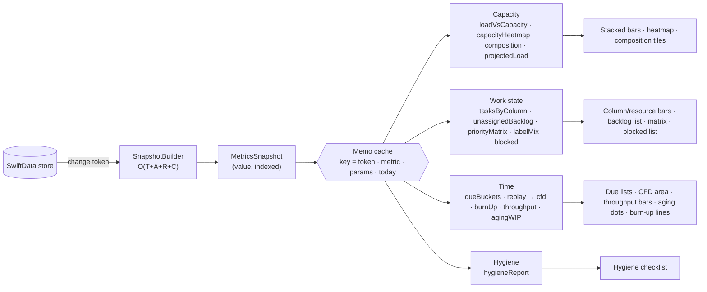

# 02 — Metrics (pure functions over one snapshot)

Every chart is fed by a **pure, synchronous** function `(MetricsSnapshot, params) -> Value`. These functions use no
SwiftData, no `Date()` and no `Calendar.current`. They live in `Sources/TickyTask/Kanban/Services/KanbanMetrics*.swift`
and are pinned by `Tests/TickyTaskTests/KanbanMetrics*Tests.swift`.

## 0. Snapshot, notation, calendar

`MetricsSnapshot` is a value type, built once per change token by `KanbanMetricsSnapshotBuilder`. It holds:
- `project`, `columns` (in board order) and `resources`;
- `tasks`, as DTOs with `labels`, `subtasks` and `dependsOn: [UUID]`;
- `activities`, **ordered** by their persisted `seq` (per project, from `project.nextActivitySeq`). `at` supplies the
  calendar information — replay's daily cutoffs and ages;
- `now` (read fresh on every rebuild), `cal` and the cache key `(projectID, storeGeneration, clock)` (01 §2.5);
- the pre-built indices `columnByID`, `tasksByResource` and `activitiesByTask`.

| Symbol | Definition |
|---|---|
| `day(x)` | `cal.startOfDay(for: x)`. `cal` uses the user's `TimeZone`, with `firstWeekday = weekStartsMonday ? 2 : 1` |
| `today` | `day(now)` |
| `Δd(a,b)` | `cal.dateComponents([.day], from: day(a), to: day(b)).day!`: calendar days, never `/86400`, so DST-safe |
| `W(x)` | `WeekMath.startOfWeek(containing: x, weekStartsMonday:, calendar: cal)`. Week `k` is `[W(today)+7k days, +7)` |
| `live(t)` | `t.archivedAt == nil` |
| `open(t)` | `live(t) ∧ kind(t.column) ≠ .done` |
| `done(t)` | `live(t) ∧ kind(t.column) == .done` |
| `m(t)` | count mode: `1`; hours mode: `t.estimateHours ?? project.defaultEstimateHours` (an explicit `0` counts as an estimate) |
| `w(t)` | `weightedLoad ? max(t.isCritical ? 2 : 1, t.priority == .high ? 1.5 : 1) : 1` |
| `v(t)` | `m(t) · w(t)`, the load contribution. **Only metrics 1 and 2 and the drag preview use `w`;** the work-state metrics use raw `m` |
| `v₀(t)` | this week's share of the load. Count mode: `v(t)`. Hours mode: the share of `v(t)` that the §1 heatmap distributes into week 0, which is 0 for a task scheduled entirely next week |
| `workDays(range)` | the days in `range` whose weekday is in `project.workWeekDays` |

**Why weights use `max`, not a product.** "Critical" and "High" both signal urgency, not more effort.
- A product (×3) would make one Critical High task count like three tasks.
- `max` stays bounded to `[1, 2]`, never lowers a task's weight when you add a flag, and doesn't depend on which flag was
  set first.
- The sum of the extra weight (2.5) was rejected for the same reason as the product.

**Capacity of a resource `r`.** Let `a = r.allocationPercent / 100` (full-time = 100).
- **Count target:** `C(r) = r.openTaskTargetOverride ?? project.openTaskTarget · a`. It is **kept fractional**, so a
  50 % part-timer's target is 2.5. Rounding would turn 1–10 % allocations into 0 or 1, and both are wrong.
- **Hours target:** `H(r) = r.capacityHoursPerWeekOverride ?? project.defaultCapacityHoursPerWeek · a`.
- **Overrides are absolute** (they are not scaled by `a`).
- `T(r)` is `C(r)` in count mode and `H(r)` in hours mode.

**Utilisation.** `L(r) = Σ v₀(t)` over the open tasks assigned to `r`. This is **this week's** load, and it is the baseline
shared by the headline, its segments, the band and the drag preview.
- In count mode `v₀ = v`, so `L` is the weighted open-task count.
- Total open load `B(r) = Σ v(t)` is used **only** for hours-mode backlog coverage (`B / H`).
- If `T(r) > 0`: `u = L / T`. The band is green for `u ≤ 0.8`, amber for `u ≤ 1.0`, and red above that. Band edges are
  compared with `ε = 1e-9`, so exactly 0.8 is green.
- If `T(r) == 0`: the result is `.noCapacity(load: L)`. There is never a division.
- Percentages are rounded only for display.

**Contract with 01 (activity payloads).**
- `created` carries the column and resource.
- `moved` carries the from/to column and the from/to resource ids.
- Setting `isBlocked` emits `edited(field: .isBlocked, new: true)`.
- Each column reference stores a snapshot of the column's `name` and `kind`, so deleted columns still replay.

## 1. Capacity

**(1) `loadVsCapacity(s, filter: ResourceFilter) -> [ResourceLoadRow]`**
- **Units.** In count mode, `load` is the open-task count against the open-task target.
- In hours mode, `load` is **this week's distributed hours**: column 0 of the §2 heatmap's load, against `H(r)`. That is a
  true weekly utilisation.
- Hours mode also reports **backlog coverage** as a separate figure, `B(r) / H(r)` in weeks. It is never mixed into
  the band.
- Rows are the non-archived resources that pass `filter.employment ⊆ {FTE, Contractor}` and
  `filter.assignment ⊆ {fullTime, partTime}`.
- Each row has `segments[columnID] = Σ v₀(t)` over open tasks, one segment per non-done column in board order, plus `load`
  (= Σ segments), `target`, `utilisation` and `band`. In hours mode the headline, its segments and the drag preview all use
  this week's hours; total open hours appear only in **backlog coverage**.
- An **Unassigned** pseudo-row shows its segments with no target.
- Edges: a resource with a zero target is `.noCapacity`; an empty filter gives `[]`.

**Drag preview — `projectedLoad(s, r, dragged: Set<UUID>, drop: (column, resource?)) -> ResourceLoadRow`**
- Let `t′` be `t` with the drop's column and resource applied, and `counts(x, r) = x.resource == r ∧ open(x)`. Then
  `L′(r) = L(r) + Σ_{t∈D} v₀(t)·([counts(t′,r)] − [counts(t,r)])`. It uses the same weekly units as the headline.
- It is evaluated for both the source and the destination resource, so dragging out subtracts.
- Dropping into Done subtracts. A task already counted for `r` adds 0.
- It reuses the memoised `L`, so the cost is O(|D|).

**(2) `capacityHeatmap(s, weeks N: 1…26) -> [[HeatCell]]`** has one row per non-archived resource and counts **open tasks
only**.

Task window `[s_t, e_t]`:
- `s0 = day(start ?? due ?? today)` and `e0 = day(due ?? s0)`;
- `s_t = min(s0, e0)` and `e_t = max(s0, e0, today)`.

The swap uses both endpoints, so start Oct 30 / due Oct 20 still reaches Oct 30.

What that means for each kind of task:
- no dates → the current week;
- only a due date → the due week;
- **only a start date → from the start week through the current week** (just the start week if the start is in the future);
- overdue work → clamped into the current week, so it doesn't drop off the chart.

Load per week:
- **Count mode:** `v(t)` is added to every week the window touches.
- **Hours mode:** `v(t)` is spread evenly over `workDays([max(s_t,today), e_t])`. If that set is empty, it all goes to
  `W(e_t)`. Copying a 40 h task into every week of its window would overstate it.

Target per cell: `T_k = T(r) · f_k`, where
`f_k = |workDays(week_k ∩ [r.startDate ?? −∞, r.endDate ?? +∞])| / |workDays(week_k)|`. The current week is counted whole.

Cell value:
- `T_k > 0` → `load_k / T_k`, with a band;
- `T_k == 0` → `.unavailable(load_k)`, flagged if the load isn't zero;
- an empty `workWeekDays` → `.noCapacity` in every cell.

**(3) `composition(s) -> Composition`**
- A resource is *active* when it isn't archived and `day(startDate) ≤ today ≤ day(endDate)`. Missing bounds are open.
- A 2×2 grid `{FTE, Contractor} × {fullTime, partTime}` holds `count` and `Σ H(r)`. Resources that haven't started yet are
  listed separately.
- **Roll-off:** contractors with `n = Δd(today, endDate)` fall into the disjoint buckets `0…30`, `31…60` and `61…90`. An end
  date of today is 0. Each entry shows its open-task count.

## 2. Work state

These metrics use the unweighted `m(t)` over live tasks.

**(4)** `tasksByColumn(s)` gives the total per column, Done included. `tasksByResource(s)` stacks each resource by column
and includes an Unassigned bucket.

**(5) `unassignedBacklog(s)`**
- Tasks: live, `resource == nil`, in the backlog column.
- Grouped by priority (Critical is its own exclusive group) and by label (a task counts once per label; tasks without a
  label go to "No label").
- Items are sorted by `createdAt` ascending, then by `id`.
- **Ready to pull:** `ready(t) = !t.isBlocked ∧ ∀d ∈ dependsOn: done(d)`.
  - An edge to a **deleted** task no longer exists (the relationship is nullified), so it can't block.
  - An **archived** dependency is *not* satisfied, because archiving can be undone. The task shows
    "Waiting on an archived task", and the remedy is explicit: remove the dependency, or restore and finish the task.
  - Self-edges and cycles are prevented at write time (01 §1.1).
- Also reported: `unassignedActiveCount`, the unassigned tasks in active columns.

**(6) `priorityMatrix(s)`** has the rows `[Critical, High, Medium, Low]` by board columns, with `Σ m` in each cell.
**Critical is exclusive** (a Critical task appears only in that row), so the row totals add up to the column totals.

**(7) `labelMix(s)`** is `cell[column][label] = Σ m` over the tasks carrying that label.
- A task with *k* labels counts once per label, so a column's label total can exceed its task count.
- The chart therefore says "tasks with label" and never shows shares that add up to 100 %.
- Unlabelled tasks get their own bucket.

**(8) `blockedTasks(s)`**
- Tasks: open, with `isBlocked`.
- `since` is the `at` of the latest `edited(isBlocked→true)` activity, falling back to `updatedAt`, then `createdAt`.
- `ageDays = Δd(since, now)`; sorted by age, oldest first.
- The reason is `blockedReason`, trimmed, or "No reason given".

## 3. Time

**(9) `dueBuckets(s)`** uses open tasks that have a due date, with `dd = day(dueDate)`. The buckets are **mutually
exclusive** and checked in this order:
1. **Overdue:** `dd < today`.
2. **This week:** `today ≤ dd < W(today)+7`.
3. **Next week:** `W(today)+7 ≤ dd < W(today)+14`.

Overdue tasks are grouped by resource (Unassigned included) and sorted by `Δd(dd, today)`, most overdue first. Done tasks
never appear.

**Replay** is shared by metrics 10–12. `replay(s, from:, to:) -> [DayState]` is a single sweep:
- **Order and grouping:**
  - Activities apply in `seq` order.
  - A grouped activity (bulk move) and a generated inverse each carry **per-task transitions** (01 §2.3), which apply in
    the order stored.
  - Column-kind changes on populated columns are forbidden (01 §2.2), so a column's kind is constant while it holds
    tasks.
- **Per-task state:** `column` and `visible`.
  - `created` sets the column and makes the task visible.
  - `moved` sets `column = to`; a resource-only move leaves the column alone.
  - `archived` hides the task and `restored` shows it again.
  - `deleted` (task) removes the task, but its history up to that point is kept. `deleted` (column) and
    `deleted`/`archived` (resource) apply their recorded per-task transitions as moves (01 §2.3).
  - `restoredGraph` re-creates the rows and applies its forward transitions. `scheduled` doesn't change board state.
- **Tasks with no `created` activity** (data from before the log existed) get one synthesised at `createdAt`. Its column
  is the `from` of their earliest `moved`, or else their current column.
- For each day `d`, after applying the activities with `at < startOfDay(d+1)`, the replay emits each column's `count` and
  `Σ m`. Days are stepped with `cal.date(byAdding: .day, value: 1, to:)`.
- A column id that no longer exists becomes a grey band named from the stored snapshot, stacked above the live columns,
  with its kind taken from the snapshot too.
- Cost: O(A + D·C).

**(10) `cfd(s, days: 90)`** is the replay's per-column count (hours in hours mode), stacked from Done at the bottom to
Backlog at the top. Archived tasks leave on their archive day.

**(11) `throughput(s, weeks: 12)`**, titled **"Completed work (by latest completion)"**
- **A completion** is a `moved` with `kind(from) ≠ .done ∧ kind(to) == .done`. Creating a task directly in Done doesn't
  count, and neither does a Done→Done move.
- **A reopen** is a move from Done to a non-done column.
- **Each task counts once, in the week of its latest completion, and only if it is still in Done now.** Archived tasks
  still count, because the work was done.
- This deliberately rewrites earlier weeks when a task is reopened. The subtitle says so: "Reopened work moves out of
  earlier weeks".
- `reopens_w` is a separate series, and the current week is marked `partial`.
- Counting every completion event was rejected because it double-counts reopen churn.

**`agingWIP(s)`**
- Tasks: open, in **active** columns.
- `entered` is the `at` of the latest activity that put the task into its current column: `created` in it, or a `moved`
  with `to == column ∧ from ≠ column`. Resource-only moves are ignored. Falls back to `createdAt`.
- `ageDays = Δd(entered, now)`, grouped by column, oldest first.

**(12) `burnUp(s, days: 90)`** reads from the replay.
- `scope_d` is the sum of all visible bands; `completed_d` is the sum of the Done bands.
- Count mode shows tasks; hours mode shows `Σ m`.
- Limitation: estimates have no history, so hours always use today's `m(t)`.

## 4. Hygiene

**(13) `hygieneReport(s) -> [HygieneCheck: [ID]]`**

| Check | Predicate |
|---|---|
| `missingDue` | `open ∧ dueDate == nil` |
| `missingJira` | `open ∧ jiraURL` is nil, blank, or not an http(s) URL |
| `missingEstimate` | `loadMeasure == .hours ∧ open ∧ estimateHours == nil` (always empty in count mode) |
| `subtasksDoneNotDone` | `open ∧ !subtasks.isEmpty ∧ subtasks.allSatisfy(\.isDone)` |
| `doneWithOpenSubtasks` | `done ∧ subtasks.contains { !$0.isDone }` |
| `idleResources` | resources active today (as in §1.3) with 0 open tasks |
| `pastEndHoldingWork` | `day(endDate) < today ∧` open tasks > 0, **archived resources included** |

## 5. Performance and memoisation

- `KanbanMetricsCache` (`@MainActor`) is keyed by `(projectID, storeGeneration, clock, metricID, params)`, where
  `clock = (dayKey(now), timeZoneID, weekStartsMonday)`.
  - `now` is read when the snapshot is rebuilt; it is never frozen into a token.
  - The root timer, app activation and changes to the time zone or week start refresh `clock`, so midnight invalidates
    the cache without a store change.
  - A restore or import bumps `storeGeneration`.
- Overall complexity is O(T·N + A + D·C), with N ≤ 26 weeks and D ≤ 365 days. All lookups go through the pre-built
  indices; there is never a per-resource scan of every task.
- **Budget (a target to measure, not yet verified):** all metrics together take < 100 ms on the reference fixture (500 tasks, 20 resources, 10 columns,
  5 000 activities, N = 12, D = 90).
  - `metricsBudgetReferenceFixture` measures it with `ContinuousClock`.
  - The test asserts < 100 ms in Release, and < 300 ms in Debug as a canary.

## 6. Test fixtures

`MetricsFixture` builds snapshots with a fixed `cal`: Europe/London, week starting Monday, and `now` = Wed 2026-10-14 12:00.
That puts the DST change on 2026-10-25 inside the replay window. Two variants are added: a Sunday week start and
`America/Los_Angeles`.

| Metric | Function | Tests |
|---|---|---|
| Load / target / utilisation (§0) | `load`, `target`, `utilisation` | `previewBaselineMatchesHeadlineNextWeekTaskIsZero`, `loadCountsOnlyOpenUnarchived`, `partTime50TargetIs2_5`, `overrideIsAbsoluteNotScaled`, `zeroTargetIsNoCapacityNotNaN`, `bandEdges80And100Inclusive`, `weightCriticalHighIsMax2`, `hoursModeUsesDefaultEstimate`, `explicitZeroEstimateIsZero` |
| 1 Load vs capacity | `loadVsCapacity` | `hoursModeUsesCurrentWeekHours`, `backlogCoverageSeparate`, `stacksOnlyNonDoneColumnsInBoardOrder`, `filtersEmploymentAndAssignment`, `unassignedRowHasNoTarget`, `archivedResourceExcluded` |
| Drag preview | `projectedLoad` | `dragInAddsOnlyUncounted`, `dragOutSubtracts`, `dropIntoDoneSubtracts`, `sameResourceSameColumnIsZeroDelta`, `multiSelectionMixedOwners` |
| 2 Heatmap | `capacityHeatmap` | `noDatesCurrentWeek`, `dueOnlyDueWeek`, `startOnlyPastSpansToCurrentWeek`, `startOnlyFutureIsStartWeek`, `overdueClampedToCurrentWeek`, `dueBeforeStartSwappedReachesLaterEndpoint`, `doneTasksExcluded`, `hoursSpreadAcrossWorkDays`, `weekendOnlyWindowGoesToEndWeek`, `resourceStartsMidWeekProRated3of5`, `endedResourceCellUnavailableFlagsLoad`, `emptyWorkWeekNoCapacity`, `sundayWeekStart` |
| 3 Composition | `composition` | `gridCountsAndHours`, `notStartedListedSeparately`, `rollOffBucketsDisjoint`, `endTodayIsBucket0`, `fteNeverInRollOff` |
| 4 By column / resource | `tasksByColumn`, `tasksByResource` | `includesDoneExcludesArchived`, `unassignedBucket`, `unweightedEvenWhenToggleOn` |
| 5 Unassigned backlog | `unassignedBacklog` | `oldestFirstTieById`, `readyRequiresNotBlockedAndDepsDone`, `deletedDepDropsOut`, `archivedDepBlocksWithRemedy`, `multiLabelCountsPerLabel` |
| 6 Priority matrix | `priorityMatrix` | `criticalRowExclusive`, `rowTotalsEqualColumnTotals` |
| 7 Label mix | `labelMix` | `multiLabelCountedOncePerLabel`, `unlabelledBucket` |
| 8 Blocked | `blockedTasks` | `ageFromLatestBlockedActivity`, `reblockResetsAge`, `fallbackUpdatedAtThenCreatedAt`, `blankReasonPlaceholder`, `doneBlockedExcluded` |
| 9 Due | `dueBuckets` | `bucketsMutuallyExclusive`, `earlierThisWeekIsOverdue`, `dueTodayIsThisWeek`, `lateEveningDueUsesLocalDay`, `overdueGroupedByResource`, `doneNeverOverdue` |
| 10 CFD | `replay`, `cfd` | `replayOrdersBySeqNotAt`, `groupedAndInverseTransitionsReplay`, `replayMatchesCurrentBoardToday`, `resourceOnlyMoveKeepsColumn`, `archiveRestoreToggles`, `deletedTaskKeepsHistory`, `deletedColumnGreyBandUsesSnapshotName`, `legacyTaskSynthesisedCreate`, `dstWeekHasOnePointPerDay` |
| 11 Throughput / aging | `throughput`, `agingWIP` | `createdInDoneNotCounted`, `doneToDoneNotCounted`, `reopenRemovesFromOriginalWeek`, `recompleteCountsInLatestWeek`, `archivedDoneStillCounts`, `currentWeekPartial`, `agingIgnoresResourceOnlyMove`, `agingFallbackCreatedAt` |
| 12 Burn-up | `burnUp` | `scopeEqualsSumOfBands`, `completedEqualsDoneBands`, `hoursModeUsesCurrentEstimates` |
| 13 Hygiene | `hygieneReport` | one positive and one negative test per check, plus `estimateCheckEmptyInCountMode` and `pastEndIncludesArchivedResource` |
| Performance | all + `KanbanMetricsCache` | `metricsBudgetReferenceFixture`, `cacheHitSameToken`, `cacheInvalidatesOnTokenAndMidnight` |

## 7. Choices the brief left open

- Weights combine with `max`, so they stay within [1, 2].
- Count targets stay fractional.
- A task with only a start date counts from its start week through the current week.
- Overdue work is clamped into the current week. The heatmap counts open tasks only, and its window swaps on both endpoints.
- Hours mode reports this week's utilisation and backlog coverage separately.
- In hours mode, the heatmap spreads a task's hours across its working days.
- Critical is its own, exclusive priority row.
- A deleted dependency drops out; an archived one still blocks, with an explicit remedy.
- Throughput counts each task once, in the week of its latest completion, and only while it is still in Done.
- Being created directly in Done is not a completion.
- Deleted tasks keep their history.
- A resource past its end date is flagged even if it is archived.
