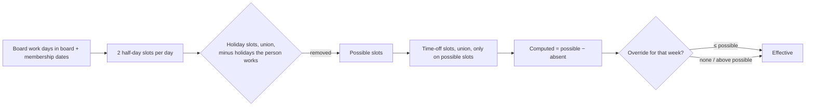

# Availability v2: public holidays, weekly availability, instructions (v0.4.0)

Builds on [03-availability.md](03-availability.md). Owner's request (2026-10-18): number-only cells; public holidays
for everyone with per-person exceptions; a weekly availability total that ignores holidays and blanks, colour-coded;
the assistant on the ChatGPT/Ollama connection, taking free-text instructions; highlight the current week. Owner's
answers: one shared holiday list; a holiday is not a working day; connection picker in the assistant; instructions may
add, change and remove (always reviewed). Codex design review: R1 changes requested (11 items), this is R2.

## Holidays

- **Model** `KanbanHoliday` (app-wide): `id`, `day` (yyyyMMdd), `name`, `portionRaw` (full/am/pm), `workedBy: [UUID]?`
  (person ids, kept sorted and unique; removed when a person is deleted; the validator rejects unknown ids),
  `createdAt`, `updatedAt`. Single days only: closures are several days.
- **Arithmetic** (half days, pure): for each work day, possible slots = {am, pm} minus the union of the slots of every
  holiday on that day the person doesn't work; absences count only on the remaining slots; duplicate holidays never
  subtract twice. "Works this holiday" exempts that one holiday record. Holidays on days that aren't board work days
  have no effect (boards may include weekends). `Member` gains `personID`; `Cell` gains `holidayHalfDays` and
  `holidayIDs`. A cell whose work days are all holidays is **"Holiday"** (its own state, not "—", still opens the
  popover so exceptions stay reachable); "—" stays for outside the board's or membership's dates.
- **Overrides** are capped by the holiday-aware possible half days everywhere, including the composite apply path
  (today it only checks 0…14); an override above it after a holiday is added uses the existing needs-review state.
- **Where it's edited:** the Availability tab's ⋯ menu → **Public holidays…** (a table: date, name, portion, people who
  work it; add, edit, delete) and the cell popover ("Works on Thanksgiving" per holiday in that week). Each sheet says
  "Applies to everyone on every board". Edits are logged on the board where they're made, like time off.
- **Change log:** activity payload **v3**; `KanbanAvailabilityDelta.holidays: [Change<KanbanHolidayDTO>]` (tolerant
  decode). Older apps refuse v3 entries by the existing version guard, so a mixed change can't be half-reverted. The
  delta's normalise/match/plan/apply/reverse/isEmpty and the history footprint (`writes()`) include holidays; undo
  checks current state as for time off.
- **Backup** v3 adds optional `holidays`; restoring an older backup warns that holidays will be removed. **Board file**
  v3 carries the holidays in the board's range (or the export range for undated boards) with `workedBy` filtered to
  people in the file. **Import** previews holidays separately ("Public holidays: adds 3, differs 1 — applies to
  everyone on every board"), with its own toggle (on for new holidays); differences keep what's here unless "use the
  file's version"; when it is used, `workedBy` keeps local exceptions for people not in the file. Dedup by id, then by
  (day, portion, name), touching `updatedAt` on adoption so older history can't delete an adopted holiday. CSV: a
  "Holiday days" column.

## Grid

- **Cells** show only the number ("4.5"), "Holiday", or "—". VoiceOver keeps "4.5 of 5 days available; 1 public
  holiday excluded". The popover: "4 of 4 working days available · 1 public holiday excluded (Thanksgiving)".
- **Weekly availability** (the Team row, already above the members): pinned under the week headers and restyled.
  `Σ effective / Σ possible` over active cells (holidays are out of possible; "—" and all-holiday cells add nothing).
  Shows the percentage, **floored** ("79%"), with "21.5 days" beneath. Bands from the unrounded ratio in integers:
  **≥ 80 % green, 60 – < 80 % amber, < 60 % red** — an app convention, labelled descriptively (high / moderate / low
  availability), with its own legend line, separate from the owner's per-person 60 % rule.
- **Current week:** header shows "This week" in the accent colour, bold date and an accent outline; the column gets a
  subtle accent tint behind the opaque cells; VoiceOver says ", this week"; keyboard focus stays visually distinct.
  Week headers show a small holiday glyph with an accessible label ("Includes Thanksgiving") — room reserved.

## Update availability

- **Connection.** The sheet shows the same connection bar as Kanban Summary (connection popover, model, effort,
  refresh), so it uses the one app-wide AI connection Weekly Summary and Kanban Summary already share
  (`weeklySummary.*` keys; Settings › AI). *Disagreement with R1-8:* a separate availability connection would make the
  owner set up ChatGPT/Ollama twice; the owner asked to "use the ChatGPT integration or similar". The disclosure names
  the destination with its host ("to Ollama at localhost:11434"), keeps "through your installed Codex CLI", and notes
  that an OpenAI-compatible server needs a Responses API. Screenshots (R2-9): the model catalog says nothing about
  vision, so image support is **known** only for the ChatGPT-account connection with a model from its
  catalog (OpenAI models through the CLI's `-i`), and **unknown** for everything else — the Codex configuration (it may
  name any provider or gateway, R3-3), local and compatible servers, and custom model ids: with screenshots
  attached the sheet says "Image support unknown for this model — an answer that ignores the screenshots can look
  complete; check the review." `SummaryModelOption` gains an optional `acceptsImages` so a model known not to read
  images disables "Suggest changes" while screenshots are attached (none is marked yet). Provider errors are shown as
  they are; images are never dropped silently and the request is never rerouted.
- **Input:** an **Instructions** field (the owner's words: "Mia is off next Tue", "cancel Ravi's PTO on Friday",
  "set Sam to 3 days the week of 2 Nov", "add Thanksgiving 26 Nov", "Ravi works on Diwali") and the material (pasted
  text, screenshots: untrusted). Either may be empty, not both. Rows from instructions have `sourceRef: "instructions"`.
- **Payload** adds, bounded to the window and the board's people: their recorded time off (ids, ranges, portion,
  kind — no notes), this board's overrides (no notes), and holidays with exceptions as names. Disclosed.
- **Reply schema 2** (strict; v1 `entries` still parse as `timeOff`):
  `{"schemaVersion":2,"operations":[…],"unresolved":[…],"warnings":[…]}`; every op has `op`, `group` (string or null),
  `sourceRef`, `evidence`, `confidence`, `issues`, plus:
  - `timeOff`: `personText`, `startDate`, `endDate`, `portion`, `kind`;
  - `removeTimeOff` ("Remove recorded time off"): `personText`, `startDate`, `endDate`, `portion` — subtracts from
    recorded entries (split with `remainder`, first piece keeps its id);
  - `override`: `personText`, `weekStart` (a Monday), `days` (0–7 in 0.5 steps) or `null` to clear;
  - `holiday`: `date`, `name`, `portion`; `removeHoliday`: `date`, `name` (null when only one that day);
  - `holidayException`: `personText`, `date`, `name` (null when only one), `works` (bool).
  Ops sharing a `group` ("move Ravi's PTO from Tue to Thu" = remove + add) are one review row, selected together.
- **Edits keep identity** (R2-5), resolved locally when a group is planned:
  - `removeHoliday` + `holiday` in one group = an **update** of that record: same `id`, `createdAt` and `workedBy`; a
    null `name` keeps the old name. "Move Diwali to Wednesday" never loses who works it (including people not on this
    board, whose exceptions the model never saw).
  - `removeTimeOff` + `timeOff` for the same person in one group = a **move**: when the removal takes a whole entry,
    the addition reuses its `id` and `createdAt`; `kind: null` and the note come from the removed entry (if the group
    removes from exactly one entry; otherwise `kind` is required). Partial removals split as before.
  - `timeOff.kind` may be null only inside such a group.
  - Only **uniquely paired** groups coalesce: one holiday removed and one added, or one person's removal from one entry
    and one addition. Any other group (two holidays moved at once, several people, several entries) is **Needs review**
    and can't be applied as an edit; the owner can ask again one change at a time (R3-1).
- **Local resolution:** people as today (alias / unique full name; otherwise unmatched); holidays to exact records by
  date (+ name), several candidates → needs review with a picker; overrides target this board's membership, a person
  not on this board → unresolved.
- **One deterministic plan** against a request-time snapshot (time off, holidays + exceptions, this board's overrides,
  board and membership dates, and the board's **work days**), re-read after generation and again immediately before
  Apply: holiday changes, then exceptions, then time-off removals, then additions, then overrides
  validated against the final holiday-aware capacity. Two selected rows that disagree about the same person and slot,
  the same week's override, or the same holiday → clash; Apply waits. Before Apply the snapshot is re-read; any change
  → "Things changed since this review — review again".
- **Review** keeps design 03's cross-board line ("Time off counts on every board they're on"). Groups New / Changes / **Removals** / Holidays (applies to everyone) / Unmatched / Needs review /
  Already true. Removals, replacements and holiday changes **start unticked**, carry a "minus.circle" icon and the word
  "Removes" or "Changes" (not colour alone), list the exact records removed and the pieces kept, and show before → after
  for each affected week ("Ravi · 19–25 Oct: 3 → 4"). The impact line counts every effective change ("Removes 1, adds
  2, changes 1 override, adds 1 holiday for everyone"), so removal-only requests can apply. Apply = one delta, one undo.
- **Safety:** the material and the model's output stay untrusted; the run stays read-only, tool-less and ephemeral;
  every limit (people, dates, capacities, ranges) is enforced locally whatever the prompt says.

## Tests

Arithmetic edge cases (duplicate/half holidays, exception per record, weekend boards, all-holiday weeks, override caps);
the weekly band boundaries and floored display; service: holiday add/edit/delete/exception with undo/redo and
cross-board undo checks; removal-only and mixed assistant changes with undo/redo; stale snapshot and clash refusal;
save failure rollback; schema-2 parse (strict, groups, ambiguous holidays, v1 still accepted); import: holiday preview,
exception preservation, adoption; v1/v2/v3 backup and board-file fixtures; a real v0.3.0 store migration + reopen;
grouped edits keep the holiday's id and exceptions and the PTO's kind and note; an ambiguous group (two holidays
moved at once) is refused into Needs review; a work-days change during generation
is caught as stale; snapshot renders (light/dark) and CI UI tests for holidays and an instruction-only request,
including keyboard navigation and VoiceOver labels.

## Version
v0.4.0 (backup, board file and activity payload formats move to v3). No tag until the owner asks; deployed locally.
